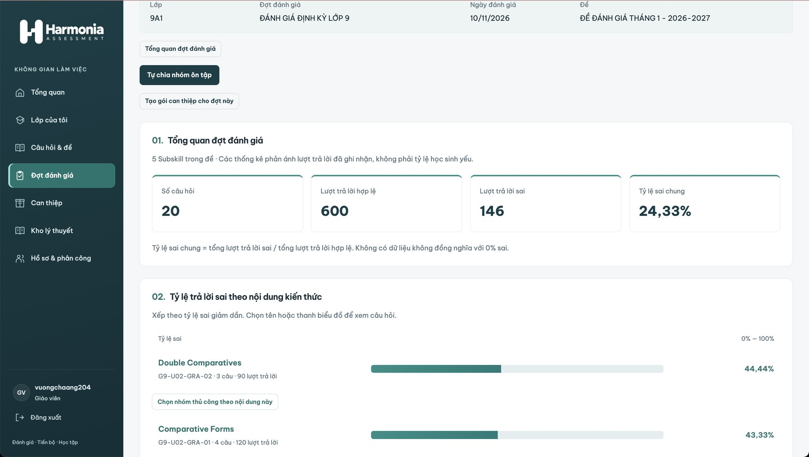

# Harmonia Assessment

**Hệ thống quản lý đánh giá và chẩn đoán kết quả học tập** môn Tiếng Anh lớp 9 – đề án môn Hệ thống thông tin.

Sau mỗi bài kiểm tra, giáo viên thường chỉ có điểm tổng. Harmonia gắn từng câu hỏi với một **kỹ năng con (Subskill)** để biết học sinh, cả lớp đang hổng ở đâu, rồi hỗ trợ giáo viên can thiệp, theo dõi và báo cáo cho phụ huynh:

**Đánh giá → Chẩn đoán → Can thiệp → Theo dõi → Báo cáo**



## Bản demo trực tuyến

**https://harmonia-web-production-19e276d6.up.railway.app** – dùng bộ dữ liệu mô phỏng giống `database/seed_demo.sql`. Tài khoản dùng thử được cung cấp riêng cho giảng viên.

## Chức năng chính

- **Học vụ:** lớp, học sinh (nhập danh sách từ CSV), giáo viên, phân công lớp theo khoảng thời gian.
- **Ngân hàng câu hỏi** theo cây kiến thức Khối → Bài → Nhóm kiến thức → Kỹ năng; tạo, sao chép, nhập câu hỏi từ CSV.
- **Đề và đợt đánh giá:** soạn đề nháp, phát hành; đề lưu bản chụp câu hỏi nên kết quả cũ không bị sai khi ngân hàng câu hỏi thay đổi.
- **Nhập kết quả CSV** theo nguyên tắc "tất cả hoặc không": xem trước, kiểm tra toàn bộ file, ghi trong một giao dịch.
- **Phân tích:** chẩn đoán cá nhân (S1), phân tích lớp (S2), tình hình tham gia (S4), tiến độ học sinh (S5).
- **Can thiệp:** gói học liệu, phiếu ôn tập cá nhân / tự chia nhóm theo nội dung sai, so sánh trước / sau (S3).
- **Báo cáo:** ghi nhận quá trình học tập, nhận xét gửi phụ huynh có gợi ý AI (Gemini, tùy chọn – giáo viên duyệt cuối cùng), báo cáo học sinh in / lưu PDF (S10).
- **Phân quyền:** hai vai trò Giáo viên và Quản lý học vụ; giáo viên chỉ thao tác trên lớp đang được phân công.

## Công nghệ

ASP.NET Core MVC trên .NET 10 (C#) · Razor + Bootstrap · Entity Framework Core 10 + Npgsql · PostgreSQL · ASP.NET Core Identity · Gemini API (tùy chọn).
Lý do lựa chọn: [docs/03-thiet-ke/cong-nghe.md](docs/03-thiet-ke/cong-nghe.md).

## Tài liệu

| Giai đoạn | Tài liệu |
|---|---|
| Khảo sát | [Hiện trạng và quy trình đề xuất](docs/01-khao-sat/README.md) |
| Phân tích | [Kịch bản S1–S10, yêu cầu, quy tắc nghiệp vụ](docs/02-phan-tich/README.md) · [Use case và đặc tả](docs/02-phan-tich/use-case.md) |
| Thiết kế | [Kiến trúc, CSDL, sơ đồ UML, giao diện, phân quyền](docs/03-thiet-ke/README.md) · [Từ điển dữ liệu](docs/03-thiet-ke/tu-dien-du-lieu.md) |
| Cơ sở dữ liệu | [Lược đồ SQL và ERD](database/README.md) |
| Kiểm thử | [24 ca kiểm thử nghiệm thu và minh chứng](docs/04-kiem-thu/README.md) |
| Quản lý dự án | [Phạm vi](docs/quan-ly-du-an/pham-vi.md) · [Kế hoạch và tiến độ](docs/quan-ly-du-an/ke-hoach-va-tien-do.md) · [Nhật ký quyết định](docs/quan-ly-du-an/nhat-ky-quyet-dinh.md) · [Bài học kinh nghiệm](docs/quan-ly-du-an/bai-hoc-kinh-nghiem.md) |

## Truy vết yêu cầu

Mỗi kịch bản nghiệp vụ được truy vết từ yêu cầu tới use case, màn hình và ca kiểm thử nghiệm thu.

| Kịch bản / chức năng | Yêu cầu | Use case đặc tả | Màn hình | Ca kiểm thử |
|---|---|---|---|---|
| Tài khoản, phân quyền | F01, BR02 | UC-01 Đăng nhập | `/Account/Login`, `/Teachers` | TC01–TC05 |
| Quản lý học sinh | F02, BR01 | – | `/Classes/{id}`, `/Classes/{id}/Import` | TC06 |
| Ngân hàng câu hỏi | F03 | – | `/Authoring/Taxonomy`, `/Authoring/Questions` | TC07–TC10 |
| S7 – Snapshot đề | F04, BR03, BR04 | UC-03 Phát hành đề | `/Authoring/Tests/Create` | TC11–TC13 |
| Tạo đợt đánh giá | F04 | UC-04 Tạo đợt đánh giá | `/Authoring/Assessments/Create` | TC14 |
| S8 – Nhập kết quả | F05, BR05, BR06 | UC-02 Nhập kết quả từ CSV | `/Assessments/{id}/Import` | TC15–TC17 |
| S1, S2, S4 – Phân tích | F06, BR07 | – | `/Assessments/{a}/Students/{s}`, `/Assessments/SubskillSummary/{id}` | TC18, TC19 |
| S5 – Tiến độ học sinh | F06 | – | `/Classes/{c}/Students/{s}/Progress` | chưa có |
| S9 – Can thiệp, phiếu ôn tập | F07, F08, BR08 | UC-05 Giao gói can thiệp | `/Interventions/{id}`, `/Worksheets/Groups/{a}` | TC20–TC22 |
| S3 – Theo dõi trước / sau | F07, BR10 | – | `/Interventions/{id}/Followups` | TC23, TC24 |
| S10 – Nhận xét, báo cáo | F09, BR09 | UC-06 Sinh nháp nhận xét bằng AI, UC-07 Duyệt nhận xét | `…/Students/{s}/Comment`, `…/Students/{s}/Report` | chưa có |
| S6 – Tiến bộ chung của lớp | – | – | – | hoãn |

Trạng thái chi tiết: [kế hoạch và tiến độ](docs/quan-ly-du-an/ke-hoach-va-tien-do.md).

## Cấu trúc thư mục

| Tệp hoặc thư mục | Nội dung |
| --- | --- |
| `Harmonia.sln` | Solution mở trong Visual Studio |
| `Harmonia.Web/Controllers/` | Tiếp nhận và xử lý yêu cầu từ giao diện |
| `Harmonia.Web/Services/` | Quy tắc nghiệp vụ, phân quyền theo phạm vi dữ liệu, nhập CSV, phân tích, can thiệp, nhận xét |
| `Harmonia.Web/Data/`, `Harmonia.Web/Models/` | `HarmoniaDbContext`, `HarmoniaIdentityDbContext` và các thực thể ánh xạ tới PostgreSQL |
| `Harmonia.Web/Migrations/` | Migration của schema tài khoản (`auth`) |
| `Harmonia.Web/Views/`, `Harmonia.Web/wwwroot/` | Giao diện Razor và tài nguyên tĩnh |
| `database/` | Lược đồ CSDL đầy đủ, ERD dạng văn bản, script nâng cấp lược đồ, truy vấn phân tích |
| `docs/` | Tài liệu khảo sát, phân tích, thiết kế, kiểm thử và quản lý dự án |

## Cài đặt và chạy

### Môi trường

- **.NET 10 SDK**.
- **PostgreSQL 16 trở lên** (khuyến nghị PostgreSQL 18) kèm **pgAdmin 4**.
- Trình soạn thảo:
  - Windows: **Visual Studio 2026** có workload **ASP.NET and web development** (Visual Studio 2022 không mở được dự án .NET 10), hoặc **Visual Studio Code** có extension **C# Dev Kit**.
  - macOS: **Visual Studio Code** có extension **C# Dev Kit**, hoặc **JetBrains Rider**.
- Kết nối Internet ở lần đầu để tải các gói NuGet.

### Bước 1. Tạo cơ sở dữ liệu

1. Mở **pgAdmin 4**, kết nối tới máy chủ PostgreSQL.
2. Nhấp chuột phải vào **Databases** → **Create** → **Database…**, đặt tên `harmonia` → **Save**.
3. Nhấp chuột phải vào CSDL `harmonia` → **Query Tool** → **Open File** → chọn `database/schema.sql` → **Execute (F5)**. Lược đồ tạo đủ 34 bảng trong hai schema `public` và `auth`.
4. (Tùy chọn) Trong **Query Tool**, mở tiếp `database/seed_demo.sql` → **Execute (F5)** để nạp dữ liệu mô phỏng: lớp 9A1 gồm 30 học sinh, 396 câu hỏi, 3 đề, 2 đợt đánh giá đã có kết quả, phiếu ôn tập và nhận xét mẫu. Dữ liệu không kèm tài khoản đăng nhập.

Hoặc dùng dòng lệnh:

```bash
createdb -U postgres harmonia
psql -U postgres -d harmonia -v ON_ERROR_STOP=1 -f database/schema.sql
psql -U postgres -d harmonia -v ON_ERROR_STOP=1 -f database/seed_demo.sql   # dữ liệu mô phỏng (tùy chọn)
```

### Bước 2. Cấu hình chuỗi kết nối

Mở `Harmonia.Web/appsettings.json`, cập nhật giá trị `HarmoniaDb` trong mục `ConnectionStrings`:

```json
"ConnectionStrings": {
  "HarmoniaDb": "Host=localhost;Port=5432;Database=harmonia;Username=postgres;Password=MAT_KHAU_POSTGRES"
}
```

Thay `MAT_KHAU_POSTGRES` bằng mật khẩu PostgreSQL trên máy; sửa `Database`, `Port`, `Username` nếu khác. Có thể khai báo bằng .NET User Secrets thay vì sửa tệp:

```bash
dotnet user-secrets set "ConnectionStrings:HarmoniaDb" "Host=localhost;Database=harmonia;Username=postgres;Password=..." --project Harmonia.Web
```

### Bước 3. Biên dịch

- **Visual Studio:** mở `Harmonia.sln` → **Build → Build Solution**.
- **Dòng lệnh** (Windows, macOS): `dotnet build Harmonia.sln`

### Bước 4. Tạo tài khoản quản lý đầu tiên

```bash
dotnet run --project Harmonia.Web --no-launch-profile -- --bootstrap-manager
```

Nhập **tên tài khoản** và **mật khẩu** (ít nhất 12 ký tự, gồm chữ hoa, chữ thường, chữ số và ký tự đặc biệt) khi Terminal yêu cầu. Lệnh tạo tài khoản **Quản lý học vụ** đầu tiên rồi kết thúc; chỉ chạy được khi CSDL chưa có tài khoản quản lý nào.

### Bước 5. Khởi chạy

```bash
dotnet dev-certs https --trust      # chỉ cần chạy một lần trên mỗi máy
dotnet run --project Harmonia.Web --launch-profile https
```

Trong Visual Studio: chọn cấu hình **https** rồi nhấn **Ctrl + F5**. Mở `https://localhost:7126` và đăng nhập bằng tài khoản ở Bước 4.

Nếu đã nạp dữ liệu mô phỏng: mở **Đợt đánh giá** → **ĐÁNH GIÁ ĐỊNH KỲ LỚP 9** để xem tổng quan, phân tích lớp, chẩn đoán từng học sinh và chia nhóm ôn tập. Để xem dưới vai trò Giáo viên, vào **Giáo viên & phân công** → hồ sơ **Vương Thuỳ Trang** (phụ trách lớp 9A1) → cấp tài khoản với mật khẩu tạm, rồi đăng nhập bằng tài khoản đó.

Nếu dùng CSDL trống: Quản lý học vụ tạo lớp, nhập danh sách học sinh, tạo hồ sơ giáo viên và phân công; câu hỏi được tạo trong mục **Câu hỏi & đề** hoặc nhập từ CSV.

Ở môi trường Development, các nhóm tính năng đã được bật trong `Harmonia.Web/appsettings.Development.json`. Gợi ý nhận xét bằng Gemini mặc định tắt (bật bằng `Gemini:Enabled` và khóa API khai báo qua User Secrets). Ứng dụng không tự migrate hay tạo dữ liệu khi khởi động.

## Giới hạn của phiên bản hiện tại

- Không tổ chức thi trực tuyến; bài kiểm tra làm trên giấy, kết quả nhập bằng CSV.
- Kết quả theo câu chỉ lưu đúng / sai, chưa lưu lựa chọn A/B/C/D.
- Chưa triển khai S6 (phân tích tiến bộ chung của lớp qua nhiều đợt).
- Báo cáo và phiếu được in / lưu PDF từ trình duyệt.

Danh sách đầy đủ: [hạn chế và hướng phát triển](docs/quan-ly-du-an/pham-vi.md#hạn-chế-hiện-tại).
