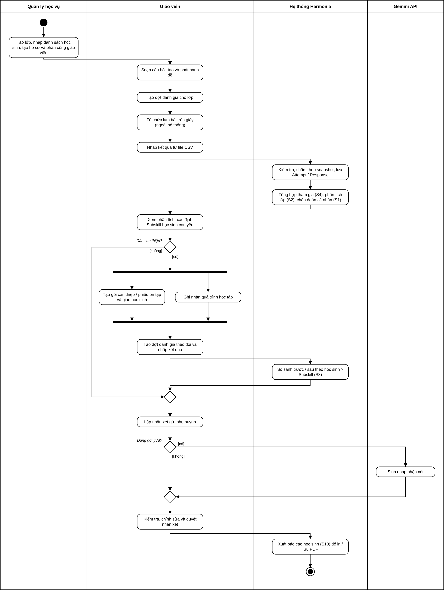

# 01. Khảo sát hiện trạng

> Nội dung trích từ báo cáo đề án môn Hệ thống thông tin (bản nộp tháng 11/2026).

## 3.1. Khảo sát hiện trạng

Quy trình đánh giá định kỳ môn Tiếng Anh thường diễn ra như sau: tổ chuyên môn hoặc giáo viên soạn đề trắc nghiệm; học sinh làm bài trên giấy hoặc phiếu tô; giáo viên chấm (thủ công hoặc bằng công cụ chấm phiếu) và ghi điểm tổng vào sổ hoặc bảng tính. Sau đó giáo viên dựa vào kinh nghiệm để quyết định ôn tập lại nội dung nào.

Qua tìm hiểu, em nhận thấy các vấn đề chính:

- **Kết quả chỉ dừng ở điểm tổng**: không có thông tin học sinh sai ở kỹ năng nào; muốn biết phải đối chiếu thủ công từng câu.

- **Đề và câu hỏi không được quản lý tập trung**: khi sửa một câu hỏi, khó biết câu đó đã nằm trong đề nào và kết quả cũ còn đúng không.

- **Can thiệp không được ghi lại**: việc giao bài ôn cho học sinh nào, khi nào, gồm nội dung gì chỉ nằm trong trí nhớ hoặc tin nhắn; không đối chiếu được kết quả trước và sau.

- **Nhận xét gửi phụ huynh tốn thời gian**, viết tay hoặc soạn rời rạc, không dựa trên số liệu thống nhất.

- **Quản lý không có cái nhìn tổng thể** về tình hình các lớp và không kiểm soát được ai được xem dữ liệu nào.

## 3.2. Quy trình nghiệp vụ đề xuất

Hệ thống Harmonia số hóa toàn bộ chu trình **Đánh giá → Chẩn đoán → Can thiệp → Theo dõi → Báo cáo**. Quy trình tổng thể được mô tả bằng sơ đồ hoạt động có làn trách nhiệm ở hình dưới đây.

*Sơ đồ hoạt động quy trình nghiệp vụ tổng thể*

Các kịch bản nghiệp vụ S1–S10 được trình bày ở [02-phan-tich](../02-phan-tich/README.md#kịch-bản-nghiệp-vụ).
