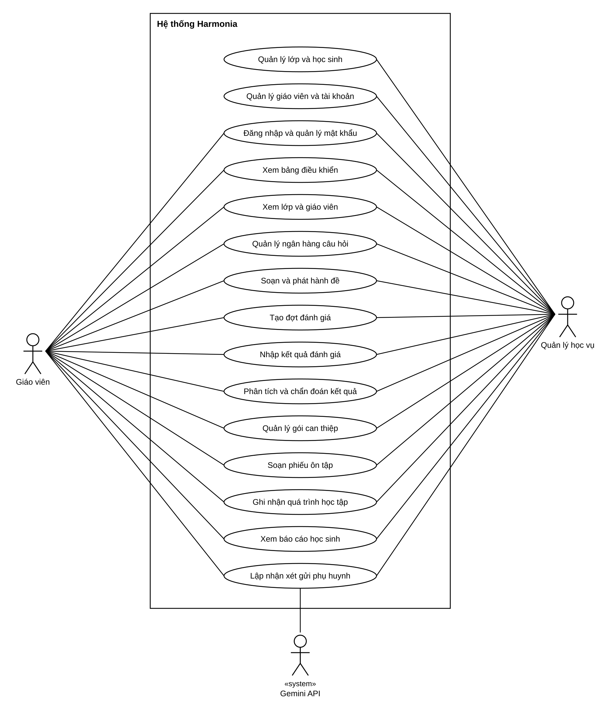
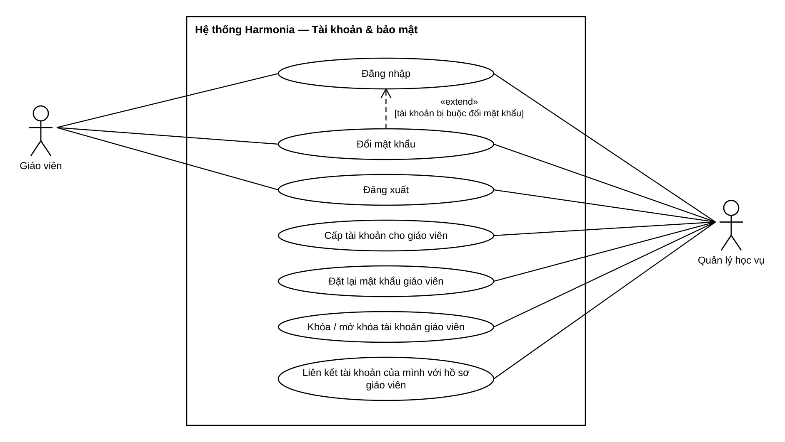
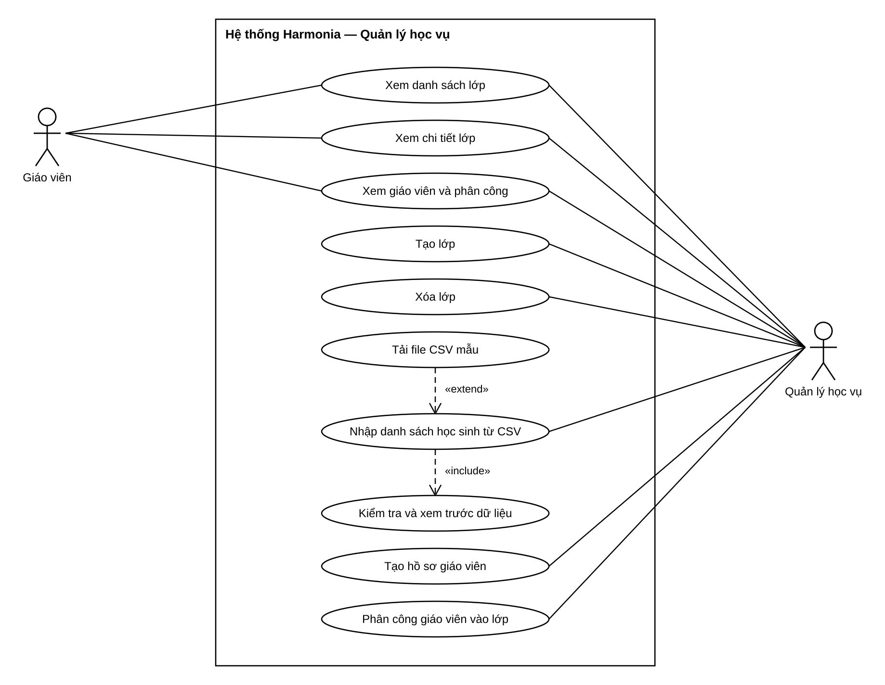
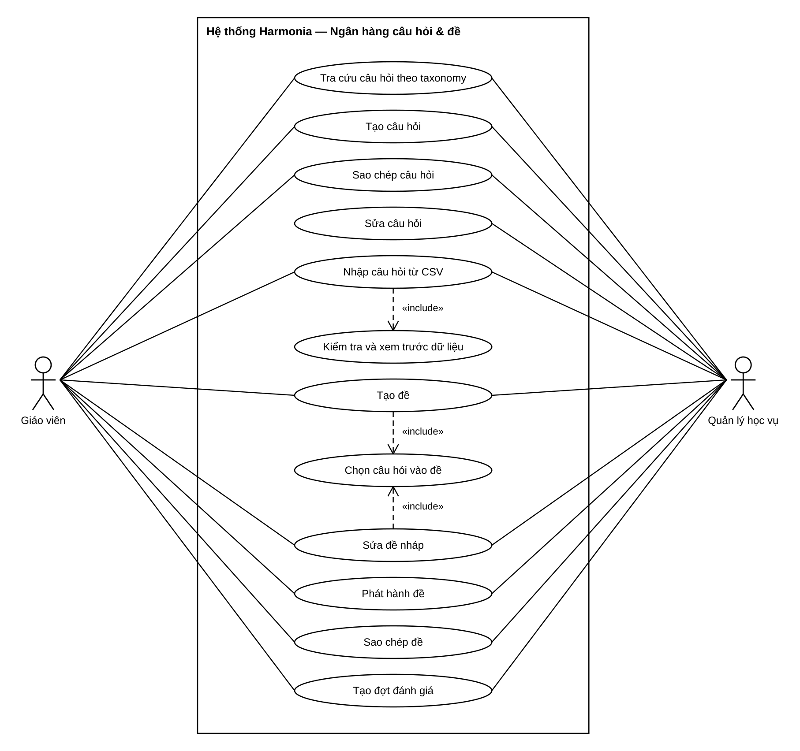
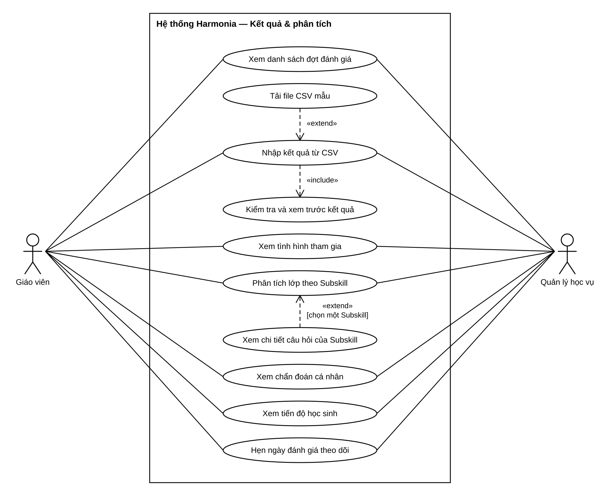
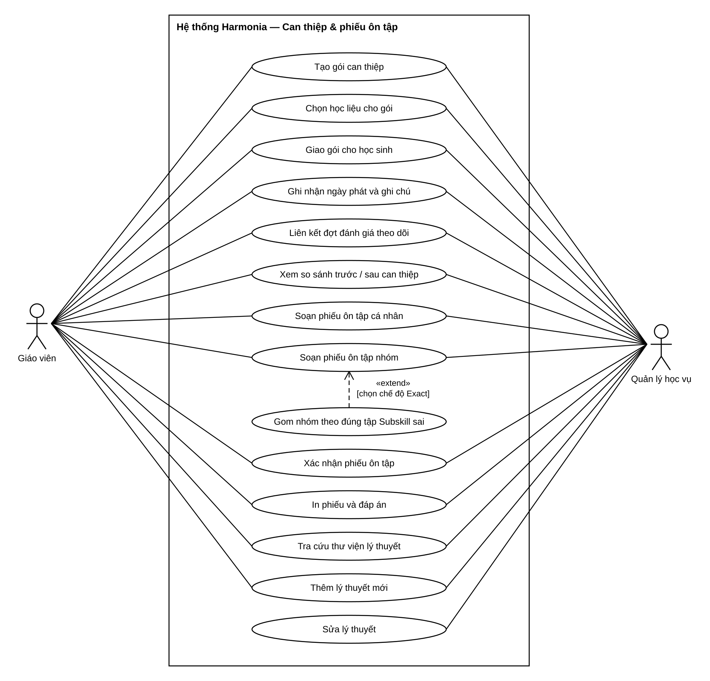
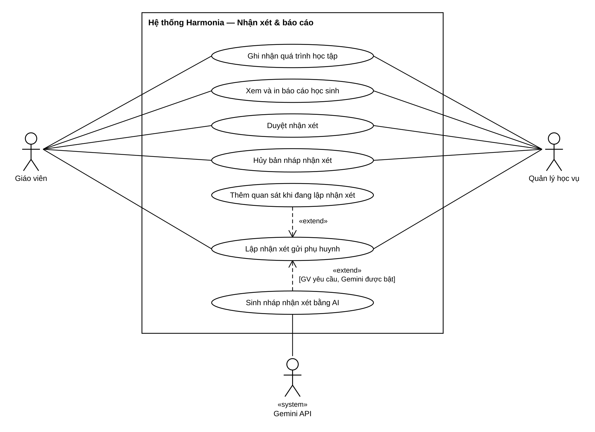

# Sơ đồ và đặc tả use case

> Nội dung trích từ báo cáo đề án môn Hệ thống thông tin (bản nộp tháng 11/2026).

## 3.7. Sơ đồ use case

### 3.7.1. Sơ đồ use case tổng quát

*Use case tổng quát*

Sơ đồ tổng quát thể hiện 15 nhóm chức năng. Nhóm quản lý lớp, học sinh và quản lý giáo viên, tài khoản chỉ dành cho Quản lý học vụ; các nhóm còn lại dùng chung cho cả hai vai trò nhưng giới hạn theo phạm vi dữ liệu. Các sơ đồ phân rã ở bên dưới.

### 3.7.2. Phân rã use case Tài khoản và bảo mật

*Use case Tài khoản và bảo mật*

### 3.7.3. Phân rã use case Quản lý học vụ

*Use case Quản lý học vụ*

### 3.7.4. Phân rã use case Ngân hàng câu hỏi và đề

*Use case Ngân hàng câu hỏi và đề*

### 3.7.5. Phân rã use case Kết quả và phân tích

*Use case Kết quả và phân tích*

### 3.7.6. Phân rã use case Can thiệp và phiếu ôn tập

*Use case Can thiệp và phiếu ôn tập*

### 3.7.7. Phân rã use case Nhận xét và báo cáo

*Use case Nhận xét và báo cáo*

## 3.8. Đặc tả use case

Phần này đặc tả 7 use case quan trọng nhất theo mẫu của Alistair Cockburn. Luồng thay thế được đánh số theo bước của luồng chính (ví dụ 4a là nhánh rẽ tại bước 4).

#### UC-01 — Đăng nhập

| Mục | Nội dung |
|---|---|
| **Sơ đồ** | [Hình 3.3 – Use case Tài khoản và bảo mật ](so-do/UC2_TaiKhoan_BaoMat.png) |
| **Tác nhân chính** | Giáo viên, Quản lý học vụ |
| **Tác nhân phụ** | Không có |
| **Mô tả** | Người dùng xác thực bằng tên đăng nhập và mật khẩu để sử dụng các chức năng theo vai trò của mình. |
| **Tiền điều kiện** | Tài khoản tồn tại, đang hoạt động (IsActive) và không bị khóa. Tài khoản có một hoặc hai vai trò hợp lệ: Teacher, AcademicManager. Nếu có vai trò Teacher: tài khoản đã liên kết với một hồ sơ giáo viên đang Active. |
| **Sự kiện kích hoạt** | Người dùng mở trang /Account/Login hoặc truy cập một trang cần đăng nhập. |
| **Luồng sự kiện chính** | 1. Người dùng mở trang đăng nhập. 2. Hệ thống hiển thị biểu mẫu gồm tên đăng nhập và mật khẩu. 3. Người dùng nhập thông tin và gửi biểu mẫu. 4. Hệ thống kiểm tra điều kiện tài khoản: đang hoạt động, không bị khóa, vai trò hợp lệ, liên kết hồ sơ giáo viên hợp lệ. 5. Hệ thống kiểm tra mật khẩu. 6. Hệ thống tạo phiên đăng nhập (hiệu lực 30 phút) chứa vai trò và mã giáo viên. 7. Hệ thống chuyển người dùng đến trang đã yêu cầu trước đó (nếu là địa chỉ nội bộ) hoặc trang danh sách đợt đánh giá. |
| **Luồng thay thế / ngoại lệ** | 3a. Bỏ trống trường bắt buộc: hệ thống báo lỗi ngay trên biểu mẫu, quay lại bước 3. 4a / 5a. Tài khoản không đủ điều kiện hoặc sai mật khẩu: hệ thống chỉ báo chung “Không đăng nhập được. Kiểm tra thông tin hoặc liên hệ quản lý.”, không tiết lộ lý do cụ thể, xóa mật khẩu đã nhập, quay lại bước 3. 5b. Sai mật khẩu 5 lần liên tiếp: tài khoản bị khóa 15 phút. 7a. Tài khoản được đánh dấu phải đổi mật khẩu (MustChangePassword): hệ thống chuyển sang use case Đổi mật khẩu; mọi chức năng khác bị chặn cho tới khi đổi xong. |
| **Hậu điều kiện** | Người dùng có phiên đăng nhập hợp lệ; mọi yêu cầu sau đó đều được kiểm tra lại điều kiện tài khoản. |
| **Đảm bảo tối thiểu** | Không tạo phiên đăng nhập cho tài khoản không đủ điều kiện; không tiết lộ tài khoản nào tồn tại. |

#### UC-02 — Nhập kết quả đánh giá từ CSV

| Mục | Nội dung |
|---|---|
| **Sơ đồ** | [Hình 3.6 – Use case Kết quả và phân tích (kịch bản S8) ](so-do/UC5_KetQua_PhanTich.png) |
| **Tác nhân chính** | Giáo viên, Quản lý học vụ |
| **Tác nhân phụ** | Không có |
| **Mô tả** | Nhập bài làm của cả lớp từ file CSV; hệ thống chấm theo đáp án snapshot của đề và ghi kết quả của tất cả học sinh trong một lần. |
| **Tiền điều kiện** | Đợt đánh giá ở trạng thái Open. Đề của đợt đã Published và có từ 1 đến 200 câu snapshot hợp lệ. Người dùng có quyền ghi: Quản lý học vụ, hoặc Giáo viên được phân công lớp cả tại ngày hiện tại và tại ngày đánh giá. |
| **Sự kiện kích hoạt** | Người dùng chọn “Nhập kết quả” tại đợt đánh giá (/Assessments/{id}/Import). |
| **Luồng sự kiện chính** | 1. Người dùng mở trang nhập kết quả của đợt đánh giá. 2. Hệ thống hiển thị thông tin đợt và số học sinh đã có kết quả. 3. Người dùng chọn file CSV (định dạng StudentCode, Q1, Q2, …) và gửi để xem trước. 4. Hệ thống kiểm tra file: mã hóa UTF-8, dung lượng tối đa 1 MB, tối đa 200 học sinh, tiêu đề cột khớp với đề, mỗi ô là A, B, C, D hoặc để trống, mã học sinh không trùng trong file. 5. Hệ thống đối chiếu từng học sinh: mã tồn tại, thuộc lớp tại ngày đánh giá, chưa có kết quả trong đợt này. 6. Hệ thống chấm từng câu theo đáp án snapshot (ô trống tính là sai), tính điểm = 10 × số câu đúng ÷ tổng số câu (làm tròn 2 chữ số) và hiển thị bản xem trước. 7. Người dùng xác nhận nhập. 8. Hệ thống kiểm tra lại quyền, trạng thái đợt và đề chưa bị thay đổi so với lúc xem trước. 9. Hệ thống ghi một ImportBatch, mỗi học sinh một Attempt và mỗi câu một Response trong cùng một giao dịch; ImportBatch chuyển sang Succeeded. 10. Hệ thống thông báo số học sinh và số câu trả lời đã ghi. |
| **Luồng thay thế / ngoại lệ** | 3a. Người dùng tải file CSV mẫu của đúng đợt đánh giá (use case mở rộng “Tải file CSV mẫu”). 4a. File sai định dạng: hệ thống liệt kê lỗi theo dòng và cột, không cho xác nhận. 5a. Có học sinh không tìm thấy, không thuộc lớp hoặc đã có kết quả: báo lỗi theo dòng; toàn bộ file không được nhập. 7a. Người dùng không xác nhận: không có dữ liệu nào được ghi. 8a. Đợt đánh giá hoặc đề thay đổi sau khi xem trước: hệ thống từ chối và yêu cầu tải file lên lại. 9a. Lỗi khi ghi: hệ thống hủy toàn bộ thao tác ghi và lưu một lần nhập trạng thái Failed kèm tóm tắt lỗi. |
| **Hậu điều kiện** | Mỗi học sinh trong file có đúng một Attempt và một Response cho mỗi câu của đề. |
| **Đảm bảo tối thiểu** | Không bao giờ có kết quả nhập một phần; mọi lần nhập (thành công hoặc thất bại) đều để lại ImportBatch. |

#### UC-03 — Phát hành đề

| Mục | Nội dung |
|---|---|
| **Sơ đồ** | [Hình 3.5 – Use case Ngân hàng câu hỏi và đề ](so-do/UC4_CauHoi_De.png) |
| **Tác nhân chính** | Giáo viên, Quản lý học vụ |
| **Tác nhân phụ** | Không có |
| **Mô tả** | Chuyển đề nháp sang trạng thái Published để dùng cho các đợt đánh giá. Đề đã phát hành không sửa được nữa. |
| **Tiền điều kiện** | Đề ở trạng thái Draft và đã có các câu snapshot (QuestionInTest) được lưu khi tạo đề. Đề chưa được dùng cho đợt đánh giá nào và chưa có câu trả lời. Giáo viên chỉ phát hành đề do chính mình tạo; Quản lý học vụ phát hành được mọi đề nháp. |
| **Sự kiện kích hoạt** | Người dùng chọn “Phát hành” trên trang chi tiết đề. |
| **Luồng sự kiện chính** | 1. Người dùng mở trang chi tiết đề nháp. 2. Hệ thống hiển thị thông tin đề và danh sách câu hỏi snapshot theo thứ tự. 3. Người dùng chọn Phát hành. 4. Hệ thống kiểm tra quyền và các điều kiện trong tiền điều kiện. 5. Hệ thống kiểm tra tính hợp lệ của toàn bộ snapshot (nội dung, bốn lựa chọn, đáp án A–D). 6. Hệ thống chuyển đề sang Published, ghi người và thời điểm cập nhật. 7. Hệ thống thông báo đề đã có thể dùng để tạo đợt đánh giá. |
| **Luồng thay thế / ngoại lệ** | 4a. Không đủ quyền hoặc đề không còn là bản nháp chưa sử dụng: hệ thống báo “Chỉ phát hành đề nháp chưa được sử dụng”, đề giữ nguyên. 5a. Snapshot không hợp lệ: hệ thống báo lỗi, đề vẫn ở Draft. 6a. Lỗi khi ghi: rollback, đề vẫn ở Draft. |
| **Hậu điều kiện** | Đề ở trạng thái Published; muốn thay đổi phải dùng “Sao chép đề” để tạo đề nháp mới. |
| **Đảm bảo tối thiểu** | Đề và snapshot không bị thay đổi khi phát hành thất bại. |

#### UC-04 — Tạo đợt đánh giá

| Mục | Nội dung |
|---|---|
| **Sơ đồ** | [Hình 3.5 – Use case Ngân hàng câu hỏi và đề ](so-do/UC4_CauHoi_De.png) |
| **Tác nhân chính** | Giáo viên, Quản lý học vụ |
| **Tác nhân phụ** | Không có |
| **Mô tả** | Tạo một đợt đánh giá gắn một đề đã phát hành với một lớp, một giáo viên phụ trách và một ngày đánh giá. |
| **Tiền điều kiện** | Có ít nhất một đề Published; lớp và giáo viên đang Active. Giáo viên chỉ tạo đợt cho chính mình và cho lớp đang được phân công; Quản lý học vụ tạo cho mọi lớp và giáo viên. |
| **Sự kiện kích hoạt** | Người dùng chọn “Tạo đợt đánh giá” từ trang đề hoặc trang lớp. |
| **Luồng sự kiện chính** | 1. Người dùng mở biểu mẫu tạo đợt đánh giá. 2. Hệ thống hiển thị các trường: tên đợt, đề đã phát hành, lớp, giáo viên phụ trách, ngày đánh giá, ngày theo dõi dự kiến (không bắt buộc). 3. Người dùng nhập thông tin và gửi. 4. Hệ thống kiểm tra quyền theo lớp và giáo viên đã chọn. 5. Hệ thống kiểm tra dữ liệu nhập; ngày theo dõi dự kiến (nếu có) phải sau ngày đánh giá. 6. Hệ thống kiểm tra lại: lớp và giáo viên đang hoạt động, đề đã Published. 7. Hệ thống kiểm tra giáo viên được phân công lớp tại ngày đánh giá. 8. Hệ thống kiểm tra snapshot của đề hợp lệ và khối của các Subskill snapshot trùng với khối của lớp. 9. Hệ thống tạo đợt đánh giá ở trạng thái Open. 10. Hệ thống thông báo tạo thành công. |
| **Luồng thay thế / ngoại lệ** | 4a. Không có quyền với lớp hoặc giáo viên đã chọn: từ chối. 5a. Dữ liệu hoặc ngày không hợp lệ: báo lỗi trên biểu mẫu, giữ nguyên dữ liệu đã nhập. 6a. Lớp, giáo viên hoặc đề vừa thay đổi trạng thái: báo lỗi, yêu cầu chọn lại. 7a. Giáo viên chưa được phân công lớp tại ngày đánh giá: từ chối; hệ thống không tự tạo phân công. 8a. Khối của đề không khớp khối lớp: từ chối. |
| **Hậu điều kiện** | Đợt đánh giá ở trạng thái Open, sẵn sàng nhập kết quả (UC-02). |
| **Đảm bảo tối thiểu** | Không tạo đợt đánh giá khi bất kỳ kiểm tra nào thất bại. |

#### UC-05 — Giao gói can thiệp cho học sinh

| Mục | Nội dung |
|---|---|
| **Sơ đồ** | [Hình 3.7 – Use case Can thiệp và phiếu ôn tập (kịch bản S9) ](so-do/UC6_CanThiep.png) |
| **Tác nhân chính** | Giáo viên, Quản lý học vụ |
| **Tác nhân phụ** | Không có |
| **Mô tả** | Giao một gói can thiệp (học liệu và/hoặc phiếu ôn tập) cho các học sinh của lớp dựa trên kết quả của đợt đánh giá nguồn. |
| **Tiền điều kiện** | Gói can thiệp tồn tại, ở trạng thái Draft hoặc Published, thuộc một đợt đánh giá mà người dùng có quyền ghi. Gói có ít nhất một học liệu, hoặc có phiếu ôn tập chứa câu luyện tập. |
| **Sự kiện kích hoạt** | Người dùng chọn học sinh và nhấn “Giao gói” trên trang chi tiết gói. |
| **Luồng sự kiện chính** | 1. Người dùng mở trang chi tiết gói can thiệp. 2. Hệ thống hiển thị học liệu, nội dung phiếu, các học sinh đủ điều kiện (thuộc lớp tại ngày đánh giá nguồn) và các học sinh đã được giao. 3. Người dùng chọn một hoặc nhiều học sinh và gửi. 4. Hệ thống kiểm tra lại gói và học liệu của gói. 5. Hệ thống kiểm tra mọi học liệu đang Active, có địa chỉ an toàn và có Subskill thuộc snapshot đề của đợt nguồn; nội dung phiếu cũng phải thuộc snapshot đó. 6. Hệ thống kiểm tra mọi học sinh được chọn đều thuộc lớp tại ngày đánh giá nguồn và chưa được giao gói này. 7. Hệ thống tạo bản ghi giao gói cho từng học sinh và chuyển gói sang Published. 8. Hệ thống thông báo số học sinh đã được giao; danh sách học liệu của gói bị khóa. |
| **Luồng thay thế / ngoại lệ** | 2a. Gói chưa có học liệu hoặc câu luyện tập: hệ thống yêu cầu thêm học liệu trước khi giao. 5a. Học liệu hoặc Subskill mục tiêu đã thay đổi: từ chối, yêu cầu kiểm tra lại gói. 6a. Có học sinh không hợp lệ: từ chối toàn bộ, không giao một phần danh sách. 6b. Có học sinh đã được giao gói này: từ chối, yêu cầu tải lại danh sách. |
| **Hậu điều kiện** | Gói ở trạng thái Published; mỗi học sinh được chọn có một bản ghi giao gói. Ngày phát thực tế được ghi sau bằng use case “Ghi nhận ngày phát và ghi chú”. |
| **Đảm bảo tối thiểu** | Không giao một phần danh sách; không tạo bản ghi giao trùng. |

#### UC-06 — Sinh nháp nhận xét bằng AI

| Mục | Nội dung |
|---|---|
| **Sơ đồ** | [Hình 3.8 – Use case Nhận xét và báo cáo (mở rộng của “Lập nhận xét gửi phụ huynh”) ](so-do/UC7_NhanXet_BaoCao.png) |
| **Tác nhân chính** | Giáo viên, Quản lý học vụ |
| **Tác nhân phụ** | Gemini API (hệ thống ngoài, tùy chọn) |
| **Mô tả** | Dùng Gemini để gợi ý nội dung nhận xét gửi phụ huynh dựa trên kết quả đánh giá và ghi nhận quá trình học tập. Kết quả luôn là bản nháp để giáo viên kiểm tra. |
| **Tiền điều kiện** | Chức năng Gemini được bật và cấu hình. Đã có bản nháp nhận xét được lưu cho học sinh trong đợt đánh giá; Giáo viên chỉ dùng bản nháp do mình tạo. Người dùng có quyền ghi với đợt đánh giá. |
| **Sự kiện kích hoạt** | Người dùng nhấn “Tạo gợi ý” trên trang nhận xét và xác nhận cho phép thay nội dung nháp. |
| **Luồng sự kiện chính** | 1. Người dùng yêu cầu tạo gợi ý. 2. Hệ thống kiểm tra quyền và kiểm tra bản nháp chưa bị thay đổi. 3. Hệ thống thu thập căn cứ: kết quả theo Subskill và ghi nhận quá trình học tập đã chọn. 4. Hệ thống gửi tới Gemini dữ liệu đã ẩn danh: điểm, số câu đúng theo Subskill và các tiêu chí quan sát; không gửi họ tên hay mã học sinh. 5. Gemini trả về đoạn nhận xét tiếng Việt. 6. Hệ thống ghi nội dung vào bản nháp với nguồn Gemini, lưu bản gốc AI, tên model, phiên bản prompt và thời điểm sinh. 7. Hệ thống thông báo người dùng kiểm tra, chỉnh sửa và duyệt trước khi gửi phụ huynh. |
| **Luồng thay thế / ngoại lệ** | 1a. Chưa lưu bản nháp: hệ thống yêu cầu lưu nháp trước. 2a / 3a. Bản nháp hoặc căn cứ đã thay đổi: báo xung đột, yêu cầu tải bản mới nhất. 5a. Gemini lỗi hoặc quá thời gian chờ (mặc định 30 giây): hệ thống báo mã lỗi; bản nháp giữ nguyên. 5b. Phản hồi không đúng cấu trúc hai phần nhận xét đã cấu hình: không ghi, bản nháp giữ nguyên. |
| **Hậu điều kiện** | Bản nháp chứa nội dung do AI gợi ý và vẫn ở trạng thái Draft. |
| **Đảm bảo tối thiểu** | Không bao giờ tự duyệt nội dung AI; bản nháp cũ được giữ nguyên khi gọi Gemini thất bại. |

#### UC-07 — Duyệt nhận xét

| Mục | Nội dung |
|---|---|
| **Sơ đồ** | [Hình 3.8 – Use case Nhận xét và báo cáo ](so-do/UC7_NhanXet_BaoCao.png) |
| **Tác nhân chính** | Giáo viên, Quản lý học vụ |
| **Tác nhân phụ** | Không có |
| **Mô tả** | Duyệt bản nháp nhận xét để đưa vào báo cáo học sinh gửi phụ huynh. |
| **Tiền điều kiện** | Có bản nháp nhận xét của học sinh trong đợt đánh giá; Giáo viên chỉ duyệt bản nháp do mình tạo. Bản nháp được soạn trên nền bản đã duyệt hiện hành (nếu có). |
| **Sự kiện kích hoạt** | Người dùng nhấn “Duyệt” trên trang nhận xét. |
| **Luồng sự kiện chính** | 1. Người dùng kiểm tra bản nháp và chọn Duyệt. 2. Hệ thống kiểm tra bản nháp chưa bị người khác sửa và người duyệt có quyền. 3. Hệ thống kiểm tra bản nháp dựa trên bản đã duyệt hiện hành và nội dung nhận xét không rỗng. 4. Hệ thống kiểm tra căn cứ (kết quả, ghi nhận quá trình) chưa thay đổi so với lúc lưu nháp. 5. Nếu đã có bản Approved, hệ thống chuyển bản đó sang Superseded. 6. Hệ thống chuyển bản nháp sang Approved, ghi người duyệt, thời điểm duyệt và snapshot căn cứ. 7. Hệ thống thông báo thành công; người dùng có thể mở báo cáo học sinh để in hoặc lưu PDF. |
| **Luồng thay thế / ngoại lệ** | 2a. Phiên bản khác với bản trên máy: báo xung đột, yêu cầu tải lại. 2b. Bản nháp do giáo viên khác tạo: từ chối. 3a. Nội dung trống: yêu cầu nhập nhận xét trước khi duyệt. 4a. Căn cứ đã thay đổi: yêu cầu kiểm tra và lưu lại bản nháp. 6a. Có người khác vừa duyệt nhận xét của cùng học sinh: hệ thống báo xung đột, không ghi đè. |
| **Hậu điều kiện** | Mỗi cặp (học sinh, đợt đánh giá) có đúng một bản Approved; bản trước đó (nếu có) ở trạng thái Superseded. |
| **Đảm bảo tối thiểu** | Khi duyệt thất bại, bản đã duyệt trước đó vẫn giữ nguyên. |
