# 03. Thiết kế hệ thống

> Nội dung trích từ báo cáo đề án môn Hệ thống thông tin (bản nộp tháng 11/2026).

- [Công nghệ sử dụng và lý do lựa chọn](cong-nghe.md)
- [Từ điển dữ liệu](tu-dien-du-lieu.md)
- [ERD dạng văn bản và lược đồ SQL](../../database/README.md)
- Tệp nguồn draw.io để chỉnh sửa sơ đồ: [drawio/](drawio/)

## 4.1. Kiến trúc tổng thể

Harmonia là ứng dụng web nhiều tầng theo mô hình MVC mở rộng. Trình duyệt gửi yêu cầu HTTPS tới **Controllers**; trước khi vào action, **Security** (bộ lọc phân quyền) kiểm tra phiên và phạm vi dữ liệu. Controller gọi **Services** – nơi chứa toàn bộ quy tắc nghiệp vụ; Services truy cập dữ liệu qua **EF Core** với hai DbContext: HarmoniaDbContext (schema public) và HarmoniaIdentityDbContext (schema auth). Riêng chức năng gợi ý nhận xét gọi ra **Gemini API** thông qua lớp GeminiCommentClient.

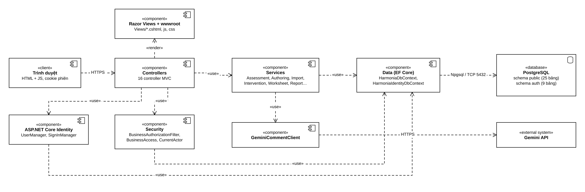

*Sơ đồ thành phần*

| **Thư mục**                      | **Nội dung**                                                                                                                            |
|----------------------------------|-----------------------------------------------------------------------------------------------------------------------------------------|
| Controllers/                     | 16 controller MVC, mỗi controller ứng với một nhóm chức năng                                                                            |
| Services/                        | Quy tắc nghiệp vụ: phân tích, nhập liệu, can thiệp, phiếu ôn tập, nhận xét, báo cáo…; Security/ chứa phân quyền; Gemini/ chứa client AI |
| Data/                            | HarmoniaDbContext, HarmoniaIdentityDbContext                                                                                            |
| Models/Entities, Models/Identity | 24 lớp thực thể và lớp người dùng mở rộng                                                                                               |
| ViewModels/                      | Dữ liệu đầu vào / đầu ra riêng cho từng màn hình                                                                                        |
| Views/, wwwroot/                 | Giao diện Razor, CSS, JavaScript, phông chữ Be Vietnam Pro                                                                              |
| Migrations/Identity              | Migration của schema auth                                                                                                               |

## 4.2. Thiết kế cơ sở dữ liệu

Cơ sở dữ liệu gồm **34 bảng, 263 cột, 53 khóa ngoại**, chia làm 6 nhóm. Các sơ đồ ERD bên dưới thể hiện đầy đủ cột, kiểu dữ liệu, khóa và ràng buộc của từng nhóm. Từ điển dữ liệu đầy đủ ở [tu-dien-du-lieu.md](tu-dien-du-lieu.md); lược đồ SQL ở [database/schema.sql](../../database/schema.sql).

### 4.2.1. Nhóm học vụ và tài khoản

Lớp, học sinh và giáo viên liên kết qua hai bảng có thời hạn: ClassMembership (học sinh thuộc lớp) và TeacherClassAssignment (giáo viên phụ trách lớp). Ràng buộc EXCLUDE ngăn khoảng thời gian chồng lấn. Bảng TeacherUserLinks nối tài khoản Identity với hồ sơ giáo viên theo quan hệ 1 – 1.

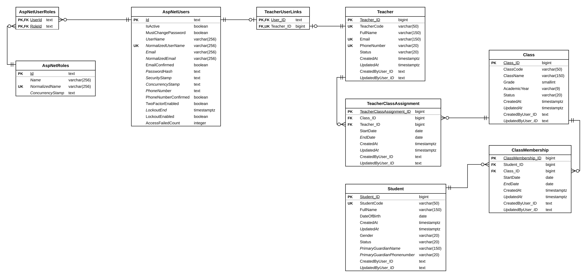

*ERD nhóm học vụ và tài khoản*

### 4.2.2. Nhóm taxonomy và ngân hàng đề

Điểm thiết kế quan trọng là bảng **QuestionInTest** lưu bản chụp (cột tiền tố SnS) nội dung, bốn lựa chọn, đáp án và Subskill của câu hỏi tại thời điểm tạo đề. Nhờ vậy, khi ngân hàng câu hỏi hoặc taxonomy thay đổi, đề và kết quả cũ vẫn giữ nguyên ý nghĩa.

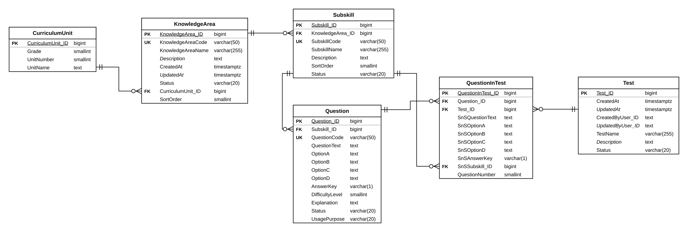

*ERD nhóm taxonomy và ngân hàng đề*

### 4.2.3. Nhóm đợt đánh giá và kết quả

Mỗi lần nhập file tạo một ImportBatch; mỗi học sinh có một Attempt cho mỗi đợt (ràng buộc duy nhất), mỗi Attempt có một Response cho mỗi câu của đề. Response chỉ lưu đúng / sai theo bản chụp của đề.

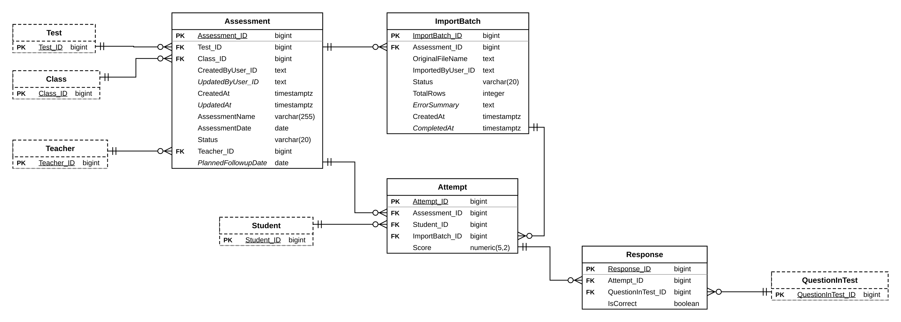

*ERD nhóm đợt đánh giá và kết quả*

### 4.2.4. Nhóm can thiệp và phiếu ôn tập

Mỗi gói can thiệp (InterventionPackage) được tạo từ kết quả của một đợt đánh giá nguồn. Học sinh nhận gói được lưu ở InterventionPackageStudent kèm ngày phát và ghi chú nội bộ; học liệu dạng đường dẫn lấy từ kho InterventionResource gắn với Subskill. Nội dung phiếu ôn tập (lý thuyết và câu luyện tập) được lưu dưới dạng bản chụp trong InterventionPackageTheory và InterventionPackageQuestion; InterventionPackageFollowup liên kết gói với các đợt đánh giá lại để so sánh trước / sau.

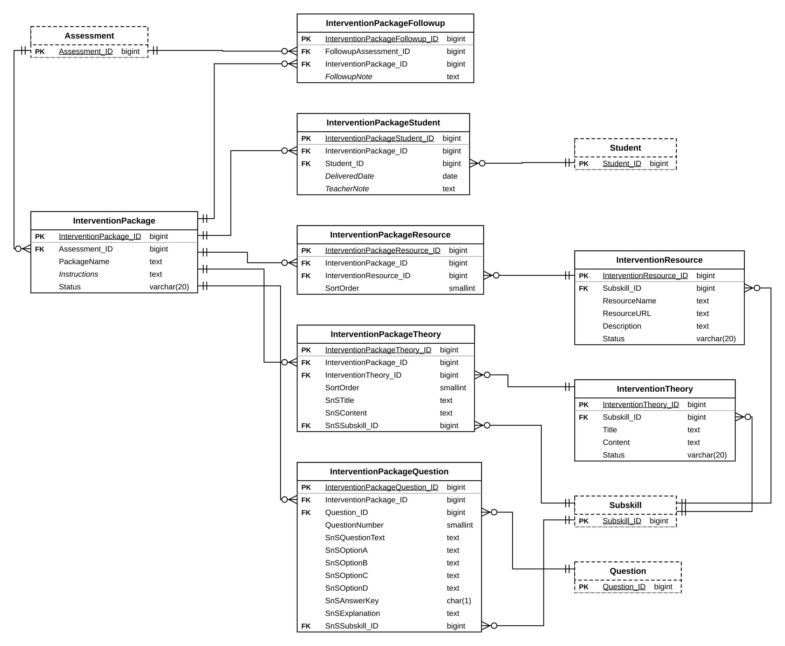

*ERD nhóm can thiệp và phiếu ôn tập*

### 4.2.5. Nhóm quan sát học tập và nhận xét

StudentReportComment lưu toàn bộ lịch sử phiên bản nhận xét (RevisionNumber), bản đã duyệt mà bản nháp kế thừa (tự tham chiếu), nguồn nội dung (Manual / Gemini) và bản chụp JSON của dữ liệu căn cứ kèm mã băm SHA-256 để phát hiện căn cứ thay đổi.

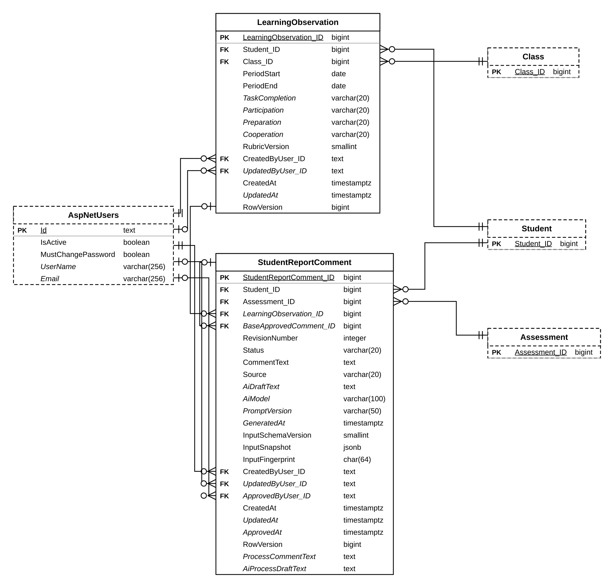

*ERD nhóm quan sát học tập và nhận xét*

### 4.2.6. Danh sách bảng

| **STT**                                  | **Tên bảng**                | **Schema** | **Số cột** | **Nội dung**                                                                                  |
|------------------------------------------|-----------------------------|------------|------------|-----------------------------------------------------------------------------------------------|
| **Học vụ**                               |                             |            |            |                                                                                               |
| 1                                        | Class                       | public     | 10         | Lớp học theo năm học.                                                                         |
| 2                                        | Student                     | public     | 12         | Hồ sơ học sinh và thông tin người giám hộ chính.                                              |
| 3                                        | ClassMembership             | public     | 9          | Thời gian học sinh thuộc một lớp; cho phép chuyển lớp mà vẫn giữ lịch sử.                     |
| 4                                        | Teacher                     | public     | 10         | Hồ sơ giáo viên.                                                                              |
| 5                                        | TeacherClassAssignment      | public     | 9          | Phân công giáo viên phụ trách lớp theo khoảng thời gian; là căn cứ phân quyền theo lớp.       |
| **Xác thực và phân quyền (schema auth)** |                             |            |            |                                                                                               |
| 6                                        | AspNetUsers                 | auth       | 17         | Tài khoản đăng nhập (ASP.NET Core Identity), bổ sung cờ hoạt động và buộc đổi mật khẩu.       |
| 7                                        | AspNetRoles                 | auth       | 4          | Danh mục vai trò: Teacher, AcademicManager.                                                   |
| 8                                        | AspNetUserRoles             | auth       | 2          | Gán vai trò cho tài khoản (một tài khoản có một hoặc hai vai trò).                            |
| 9                                        | TeacherUserLinks            | auth       | 2          | Liên kết một tài khoản với một hồ sơ giáo viên (quan hệ 1 – 1).                               |
| 10                                       | AspNetUserClaims            | auth       | 4          | Claim bổ sung của tài khoản (bảng chuẩn của Identity).                                        |
| 11                                       | AspNetRoleClaims            | auth       | 4          | Claim gắn với vai trò (bảng chuẩn của Identity).                                              |
| 12                                       | AspNetUserLogins            | auth       | 4          | Đăng nhập qua nhà cung cấp ngoài (bảng chuẩn của Identity, chưa sử dụng).                     |
| 13                                       | AspNetUserTokens            | auth       | 4          | Token của tài khoản (bảng chuẩn của Identity).                                                |
| 14                                       | \_\_EFMigrationsHistory     | auth       | 2          | Lịch sử migration của schema auth do Entity Framework Core quản lý.                           |
| **Taxonomy và ngân hàng đề**             |                             |            |            |                                                                                               |
| 15                                       | CurriculumUnit              | public     | 4          | Chương / đơn vị bài học theo khối; khối lớp được lưu ở cột Grade (không có bảng Grade riêng). |
| 16                                       | KnowledgeArea               | public     | 9          | Mạch kiến thức thuộc một chương.                                                              |
| 17                                       | Subskill                    | public     | 7          | Kỹ năng con – đơn vị nhỏ nhất dùng để chẩn đoán kết quả.                                      |
| 18                                       | Question                    | public     | 13         | Câu hỏi trắc nghiệm 4 lựa chọn trong ngân hàng, gắn với một Subskill.                         |
| 19                                       | Test                        | public     | 8          | Đề kiểm tra.                                                                                  |
| 20                                       | QuestionInTest              | public     | 11         | Câu hỏi trong đề, lưu bản chụp (snapshot) nội dung, đáp án và Subskill tại thời điểm tạo đề.  |
| **Đợt đánh giá và kết quả**              |                             |            |            |                                                                                               |
| 21                                       | Assessment                  | public     | 12         | Đợt đánh giá: một đề được dùng cho một lớp, do một giáo viên phụ trách, vào một ngày.         |
| 22                                       | ImportBatch                 | public     | 9          | Một lần nhập kết quả từ file CSV (thành công hoặc thất bại).                                  |
| 23                                       | Attempt                     | public     | 5          | Lượt làm bài của một học sinh trong một đợt đánh giá.                                         |
| 24                                       | Response                    | public     | 4          | Kết quả đúng / sai của học sinh ở từng câu (theo snapshot của đề).                            |
| **Gói can thiệp và phiếu ôn tập**        |                             |            |            |                                                                                               |
| 25                                       | InterventionPackage         | public     | 5          | Gói can thiệp tạo từ kết quả một đợt đánh giá nguồn.                                          |
| 26                                       | InterventionPackageStudent  | public     | 5          | Học sinh được giao gói can thiệp, ngày phát và ghi chú nội bộ.                                |
| 27                                       | InterventionPackageResource | public     | 4          | Học liệu thuộc gói can thiệp và thứ tự hiển thị.                                              |
| 28                                       | InterventionResource        | public     | 6          | Kho học liệu (đường dẫn) gắn với Subskill.                                                    |
| 29                                       | InterventionPackageTheory   | public     | 7          | Lý thuyết đưa vào phiếu ôn tập của gói, lưu snapshot nội dung.                                |
| 30                                       | InterventionTheory          | public     | 5          | Thư viện lý thuyết gắn với Subskill.                                                          |
| 31                                       | InterventionPackageQuestion | public     | 12         | Câu luyện tập đưa vào phiếu ôn tập của gói, lưu snapshot nội dung.                            |
| 32                                       | InterventionPackageFollowup | public     | 4          | Liên kết gói can thiệp với các đợt đánh giá theo dõi để so sánh trước / sau.                  |
| **Quan sát học tập và nhận xét**         |                             |            |            |                                                                                               |
| 33                                       | LearningObservation         | public     | 15         | Ghi nhận quá trình học tập của học sinh theo lớp và giai đoạn (4 tiêu chí).                   |
| 34                                       | StudentReportComment        | public     | 25         | Nhận xét gửi phụ huynh theo học sinh và đợt đánh giá, có lịch sử phiên bản và nguồn AI.       |

## 4.3. Sơ đồ lớp

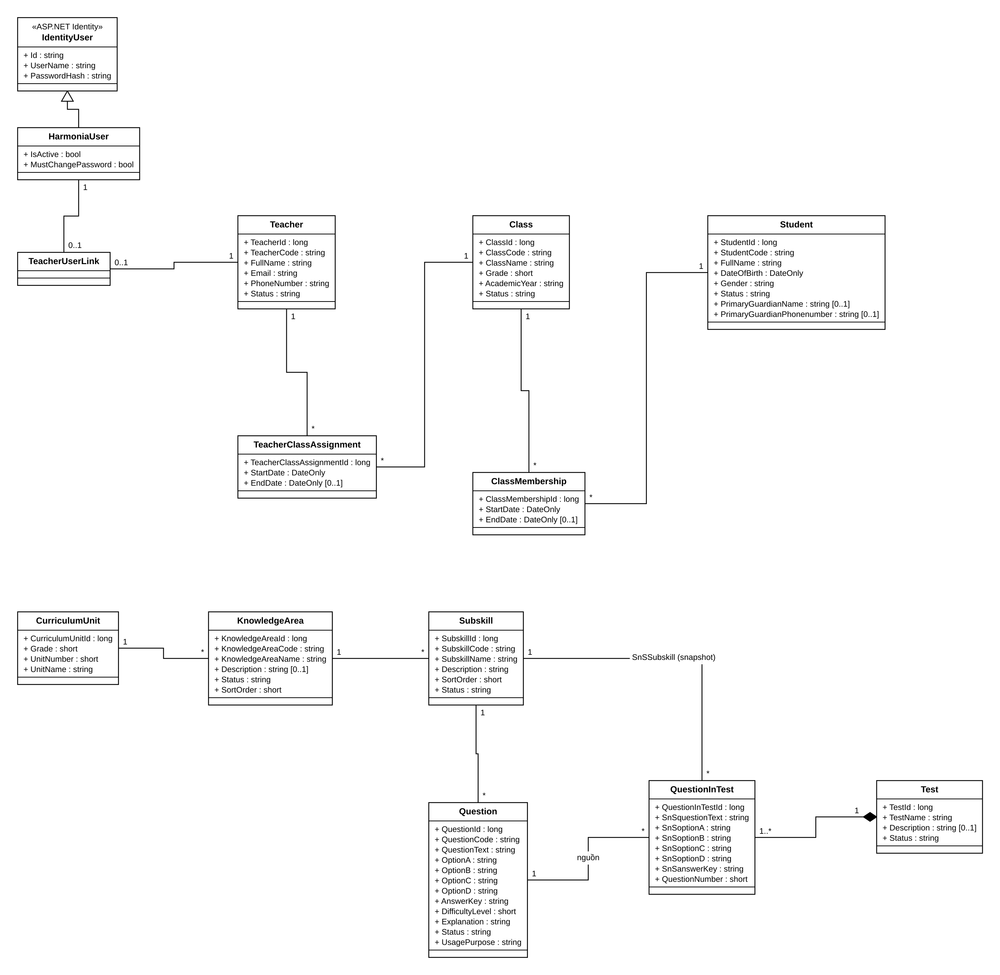

*Sơ đồ lớp nhóm học vụ, taxonomy và đề*

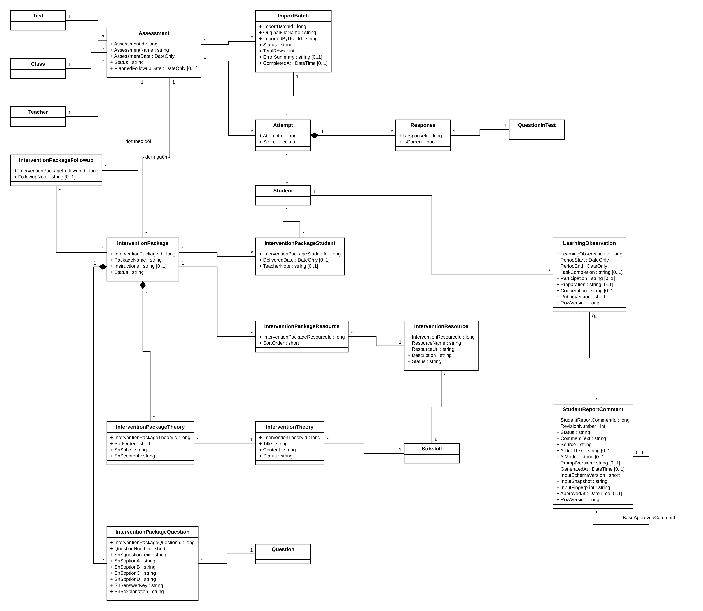

*Sơ đồ lớp nhóm đánh giá, can thiệp, nhận xét*

## 4.4. Sơ đồ hoạt động

Các sơ đồ hoạt động dưới đây mô tả chi tiết năm luồng nghiệp vụ quan trọng, gồm các bước kiểm tra và nhánh xử lý lỗi.

### 4.4.1. Nhập kết quả đánh giá từ CSV

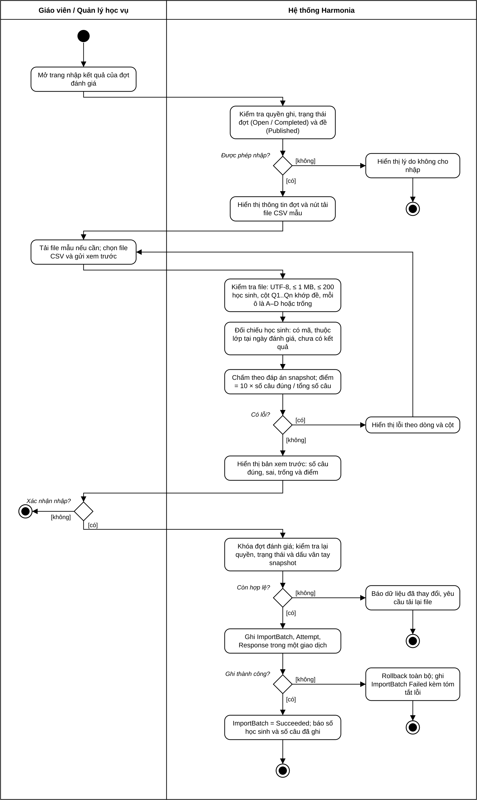

*Hoạt động nhập kết quả CSV*

### 4.4.2. Tạo và phát hành đề

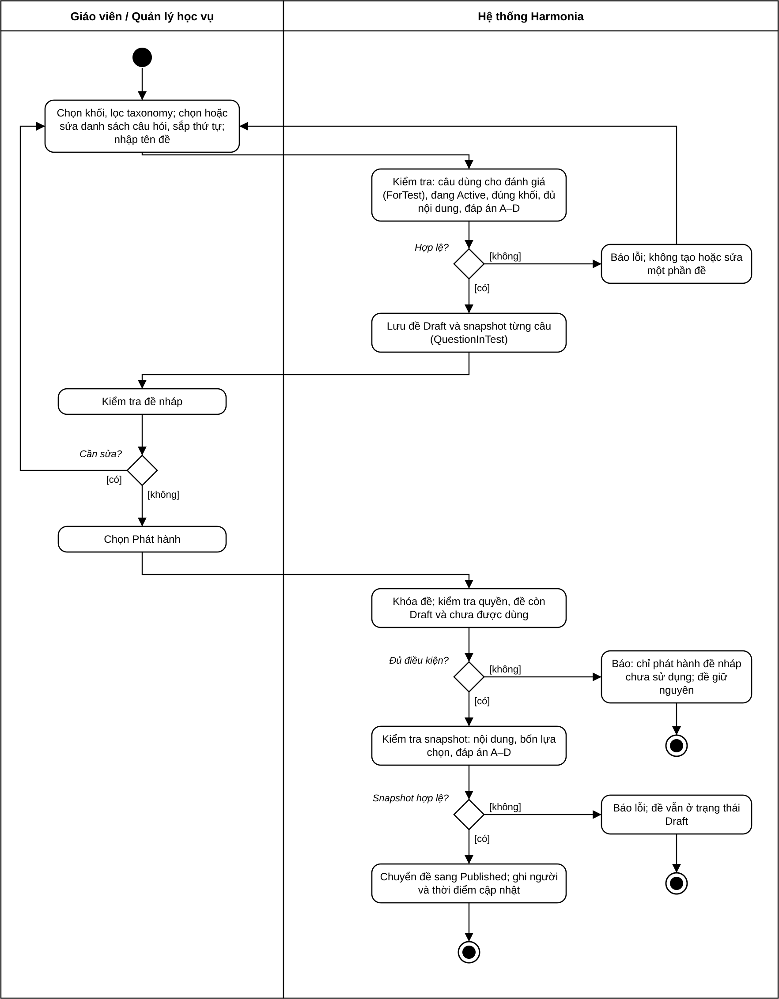

*Hoạt động tạo và phát hành đề*

### 4.4.3. Giao gói can thiệp

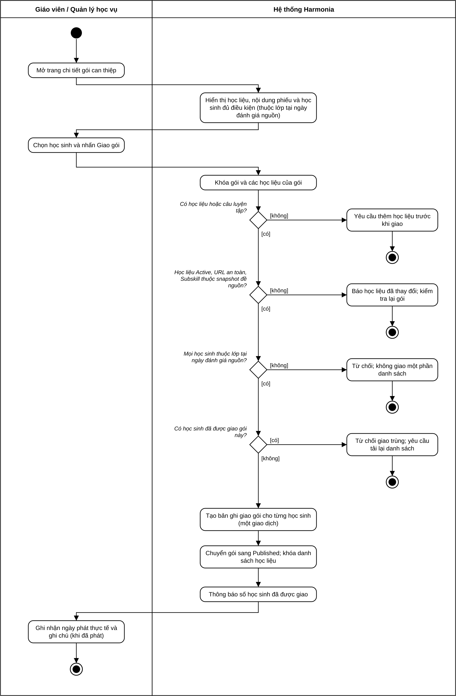

*Hoạt động giao gói can thiệp*

### 4.4.4. Soạn phiếu ôn tập theo nhóm

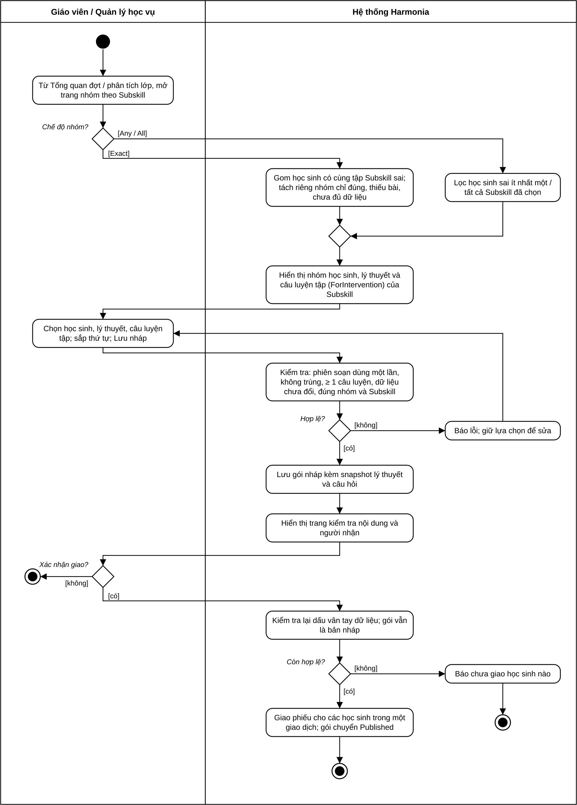

*Hoạt động soạn phiếu ôn tập theo nhóm*

### 4.4.5. Lập và duyệt nhận xét gửi phụ huynh

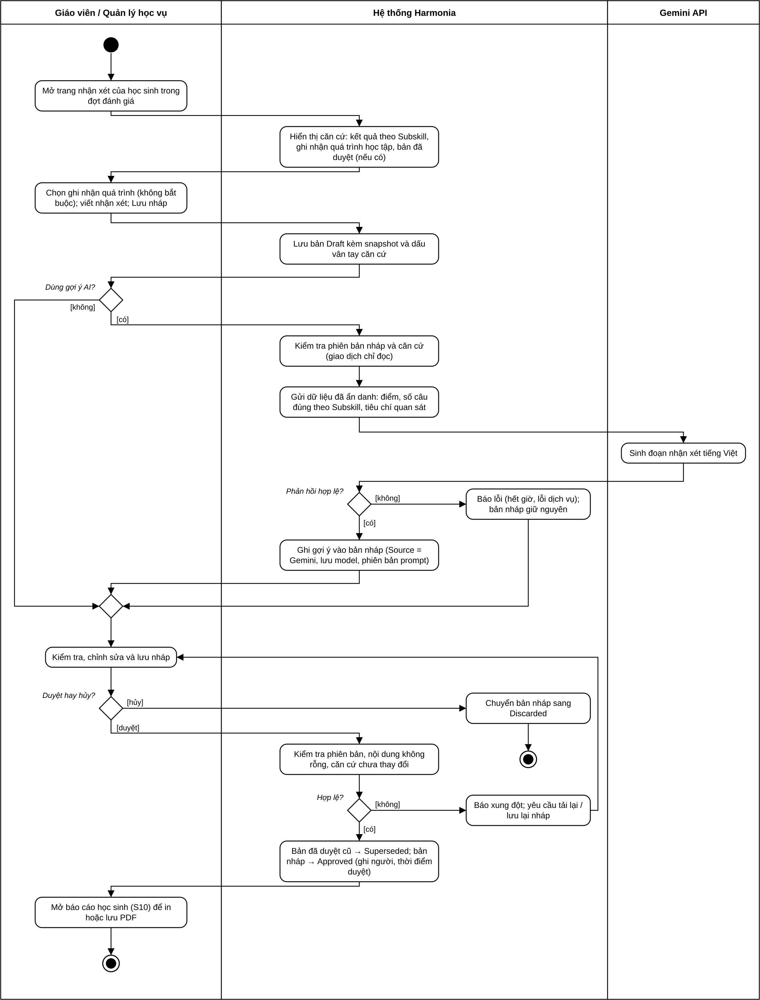

*Hoạt động lập và duyệt nhận xét*

## 4.5. Sơ đồ tuần tự

### 4.5.1. Đăng nhập

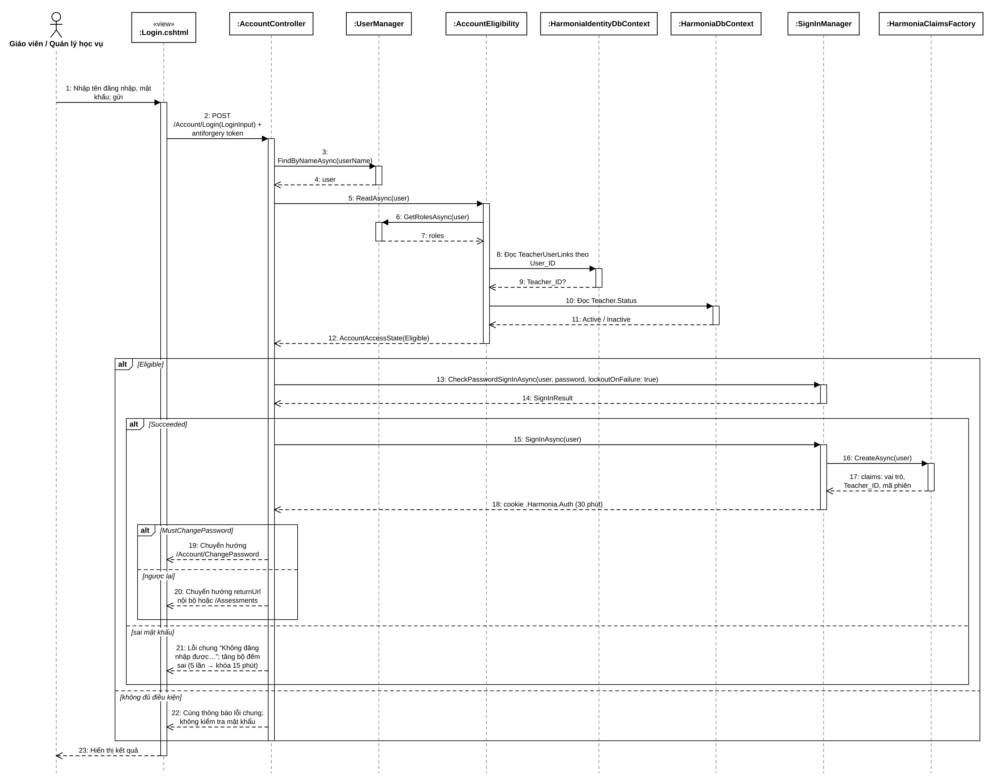

*Tuần tự đăng nhập*

### 4.5.2. Nhập kết quả đánh giá

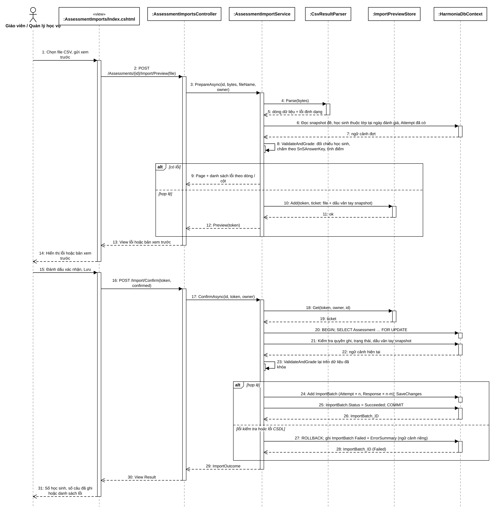

*Tuần tự nhập kết quả CSV*

### 4.5.3. Sinh nháp nhận xét bằng Gemini

Điểm thiết kế đáng chú ý: hệ thống **đóng giao dịch CSDL trước khi gọi Gemini** để không giữ kết nối và khóa trong lúc chờ dịch vụ ngoài; khi có kết quả, hệ thống mở giao dịch mới và kiểm tra lại toàn bộ (quyền, phiên bản, căn cứ) trước khi ghi.

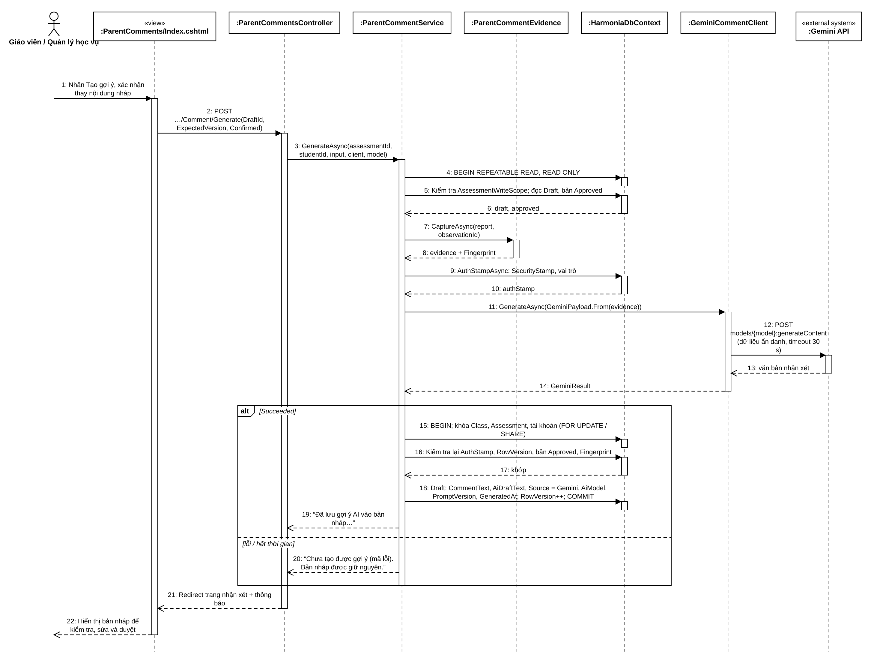

*Tuần tự sinh nháp nhận xét bằng Gemini*

## 4.6. Sơ đồ trạng thái

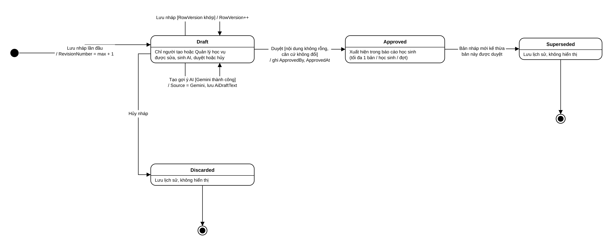

*Trạng thái nhận xét gửi phụ huynh*

Gói can thiệp và đề kiểm tra có vòng đời đơn giản hơn: tạo ở trạng thái Draft, chuyển sang Published khi giao cho học sinh đầu tiên (gói) hoặc khi phát hành (đề), nên không vẽ sơ đồ riêng.

## 4.7. Thiết kế giao diện

Giao diện dùng Bootstrap với hệ màu và phông Be Vietnam Pro riêng, menu bên trái theo nhóm chức năng: Tổng quan, Lớp tôi phụ trách, Hồ sơ và phân công, Câu hỏi và đề, Đợt đánh giá, Can thiệp, Kho lý thuyết. Menu thay đổi theo vai trò đăng nhập.

| **STT** | **Màn hình**           | **Đường dẫn**                     | **Chức năng**                                                       |
|---------|------------------------|-----------------------------------|---------------------------------------------------------------------|
| 1       | Tổng quan giảng dạy    | /                                 | Công việc cần xử lý theo vai trò, lịch đánh giá lại                 |
| 2       | Chi tiết lớp           | /Classes/{id}                     | Giáo viên phụ trách, danh sách học sinh theo ngày, tạo đợt đánh giá |
| 3       | Giáo viên và phân công | /Teachers                         | Hồ sơ, tài khoản, phân công lớp                                     |
| 4       | Cây kiến thức          | /Authoring/Taxonomy               | Lọc câu hỏi theo Khối → Bài → Nhóm kiến thức → Kỹ năng              |
| 5       | Soạn đề                | /Authoring/Tests/Create           | Chọn, sắp xếp câu hỏi, lưu nháp                                     |
| 6       | Nhập kết quả           | /Assessments/{id}/Import          | Tải mẫu, xem trước kết quả chấm, xác nhận                           |
| 7       | Phân tích lớp          | /Assessments/SubskillSummary/{id} | S2: tỷ lệ trả lời sai theo nội dung kiến thức                       |
| 8       | Chẩn đoán cá nhân      | /Assessments/{a}/Students/{s}     | S1: kết quả theo từng kỹ năng của một học sinh                      |
| 9       | Chia nhóm ôn tập       | /Worksheets/Groups/{a}            | Gom học sinh theo nội dung sai, soạn phiếu cho nhóm                 |
| 10      | So sánh trước / sau    | /Interventions/{id}/Followups     | S3: so sánh kết quả trước và sau can thiệp                          |
| 11      | Nhận xét gửi phụ huynh | …/Students/{s}/Comment            | Lưu nháp, gợi ý AI, duyệt                                           |
| 12      | Báo cáo học sinh       | …/Students/{s}/Report             | S10, in / lưu PDF                                                   |

### Ảnh chụp màn hình

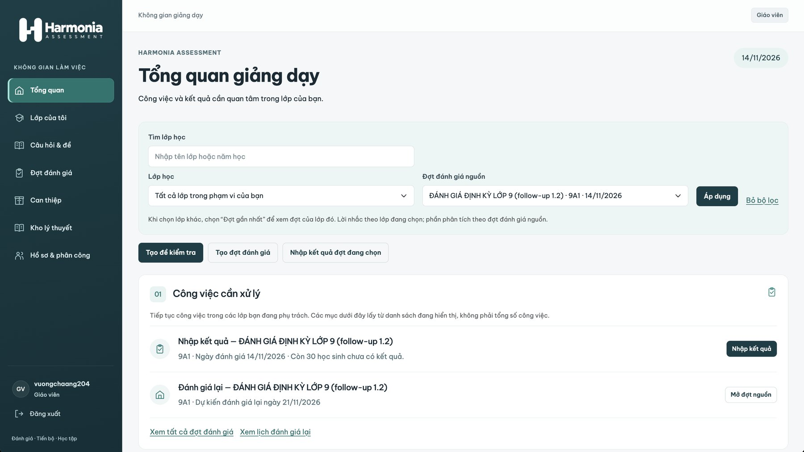

*Tổng quan giảng dạy*

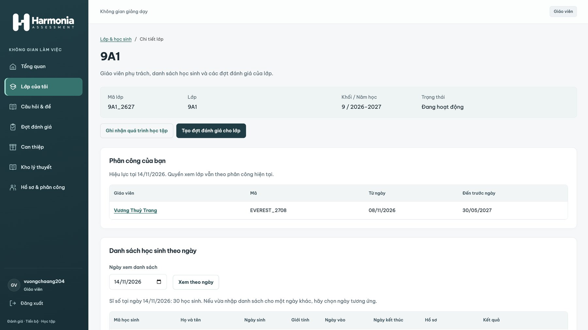

*Chi tiết lớp (Giáo viên)*

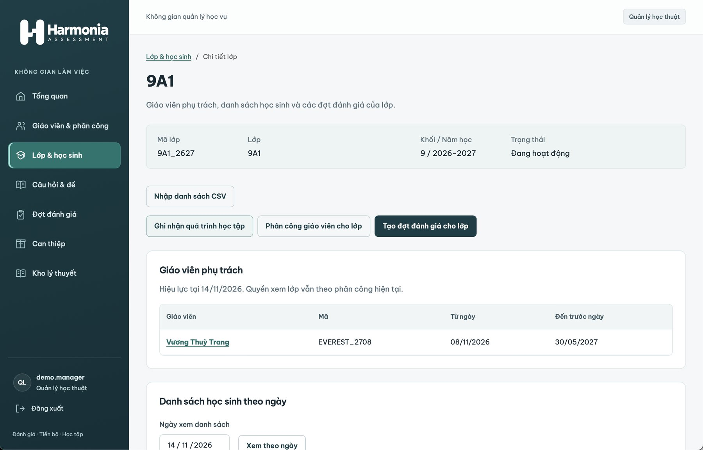

*Chi tiết lớp (Quản lý học vụ)*

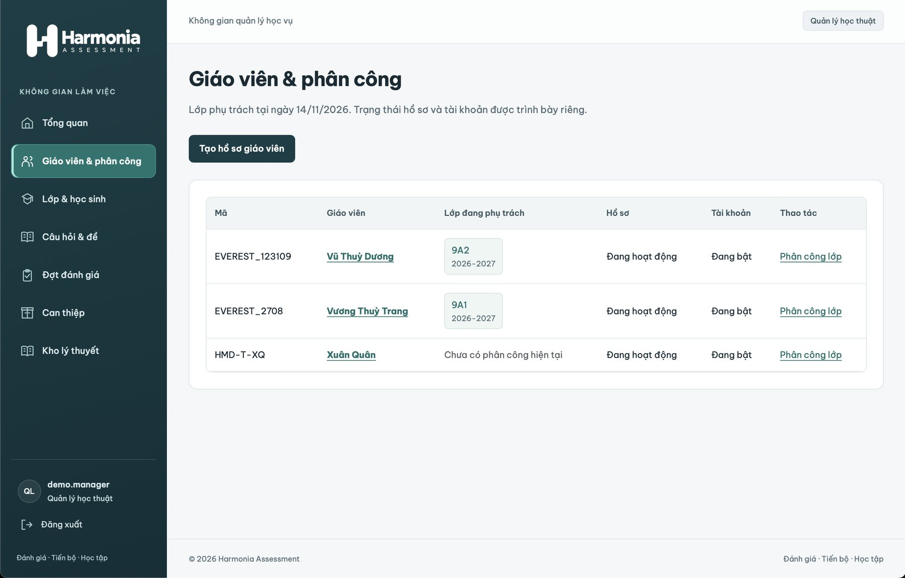

*Giáo viên và phân công*

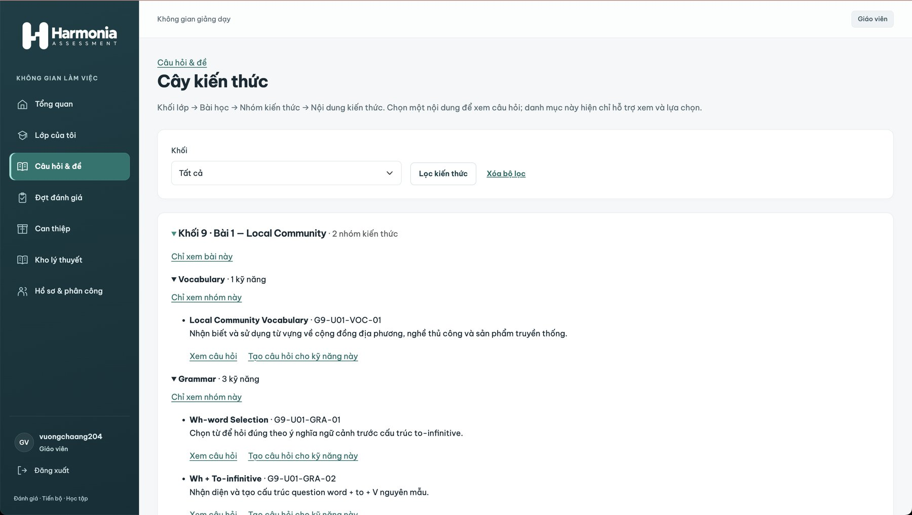

*Cây kiến thức*

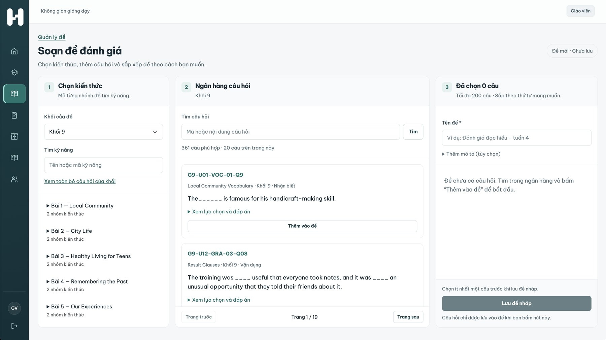

*Soạn đề*

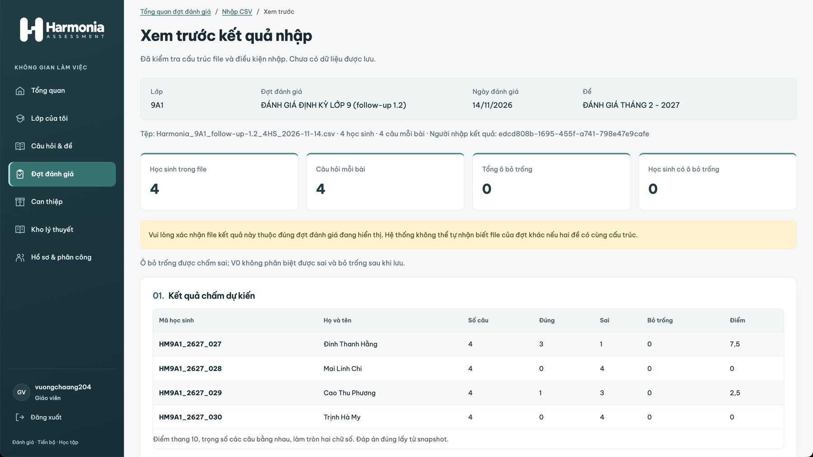

*Xem trước kết quả nhập*

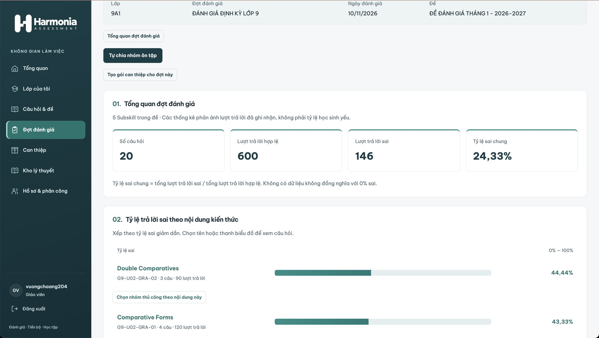

*Phân tích lớp (S2)*

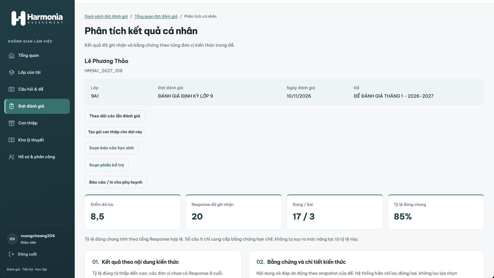

*Chẩn đoán cá nhân (S1)*

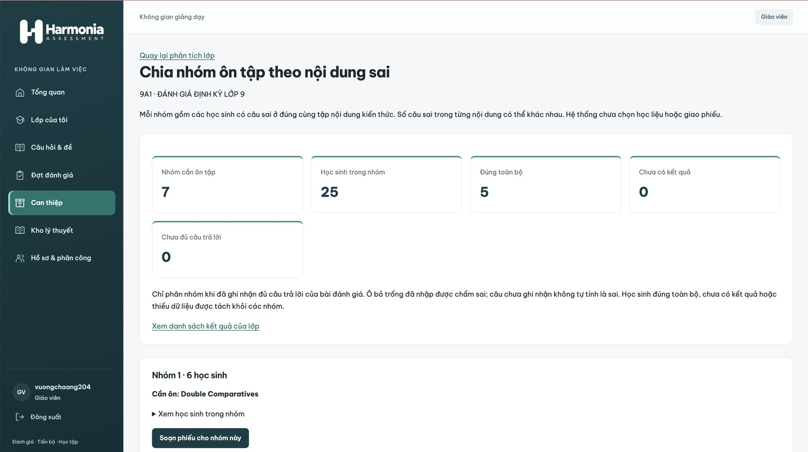

*Chia nhóm ôn tập*

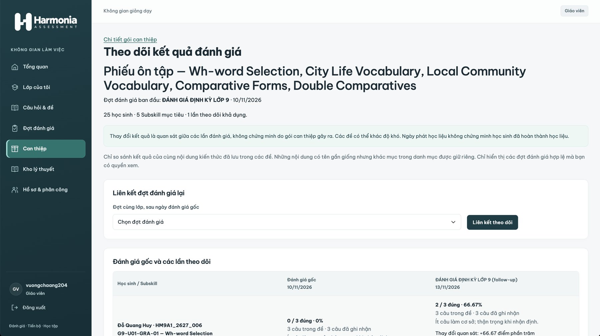

*Theo dõi sau can thiệp (S3)*

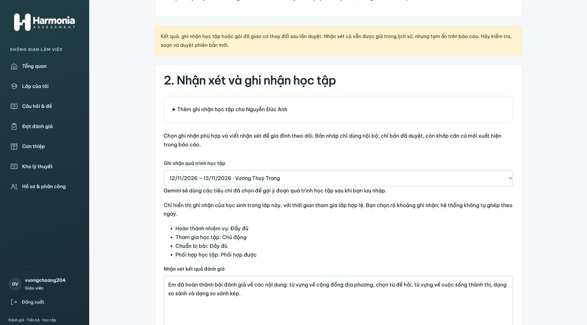

*Nhận xét gửi phụ huynh*

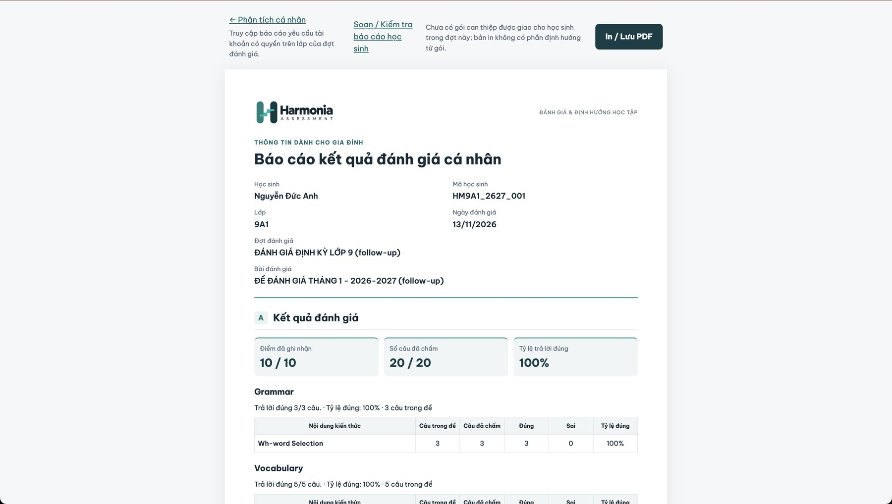

*Báo cáo học sinh (phần đầu)*

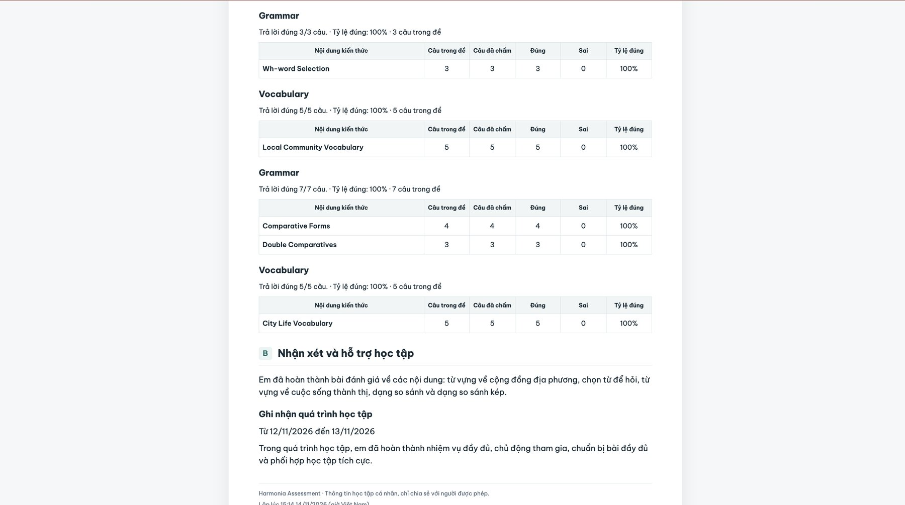

*Báo cáo học sinh (phần cuối)*

## 4.8. Thiết kế phân quyền

Hệ thống kiểm tra quyền ở hai mức:

1.  **Đăng nhập:** mọi trang đều yêu cầu đăng nhập, trừ trang đăng nhập. Mật khẩu tối thiểu 12 ký tự; sai 5 lần liên tiếp thì tài khoản bị khóa 15 phút; tài khoản mới phải đổi mật khẩu ở lần đầu; phiên đăng nhập hết hạn sau 30 phút.

2.  **Phạm vi dữ liệu:** trước khi xử lý mỗi yêu cầu, hệ thống kiểm tra người dùng có quyền với lớp / đợt đánh giá đó không. Quản lý học vụ được thao tác trên toàn bộ dữ liệu; Giáo viên chỉ thấy lớp mình đang được phân công. Nếu không có quyền, hệ thống trả về trang “Dữ liệu không tồn tại hoặc nằm ngoài phạm vi quyền”.

Ngoài ra, các biểu mẫu đều có mã chống giả mạo yêu cầu (antiforgery token); chuỗi kết nối CSDL và khóa Gemini được cấu hình ngoài mã nguồn.
