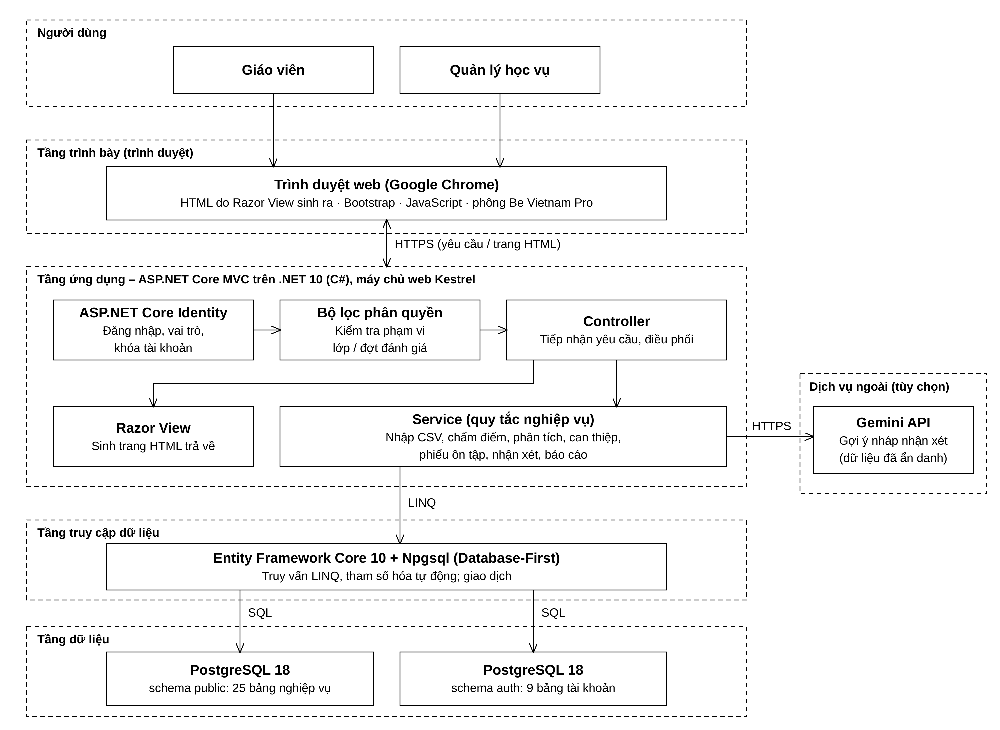

# Công nghệ sử dụng và lý do lựa chọn

> Nội dung trích từ báo cáo đề án môn Hệ thống thông tin (bản nộp tháng 11/2026).

## 2.5. Công nghệ sử dụng và lý do lựa chọn

Việc chọn công nghệ dựa trên năm tiêu chí rút ra từ đặc thù nghiệp vụ: (1) **toàn vẹn dữ liệu** là yêu cầu hàng đầu vì điểm số và báo cáo gửi phụ huynh không được sai lệch; (2) **giao dịch và đồng thời** – nhiều giáo viên có thể thao tác cùng lúc trên cùng dữ liệu lớp; (3) **bảo mật và phân quyền** sẵn có, đã được kiểm chứng; (4) **phù hợp quy mô** – ứng dụng nội bộ cho một trường, chủ yếu là biểu mẫu và báo cáo in; (5) **chi phí** – ưu tiên nền tảng mã nguồn mở, miễn phí.

Hình dưới đây thể hiện các công nghệ được sử dụng và vị trí của chúng trong từng tầng của hệ thống; lý do lựa chọn từng công nghệ được tổng hợp ở bảng bên dưới.

*Sơ đồ tổng quan công nghệ*

| **Thành phần**       | **Công nghệ chọn**                                            | **Phương án đã cân nhắc**                 | **Lý do chính**                                                                                                                                                  |
|----------------------|---------------------------------------------------------------|-------------------------------------------|------------------------------------------------------------------------------------------------------------------------------------------------------------------|
| Nền tảng ứng dụng    | ASP.NET Core MVC trên .NET 10, ngôn ngữ C#                    | Node.js / Express, Django, Laravel        | Kiểu tĩnh mạnh, hiệu năng cao, có sẵn DI, chống CSRF, Identity; .NET 10 là bản hỗ trợ dài hạn (LTS)                                                              |
| Giao diện            | Razor View + Bootstrap + JavaScript thuần                     | SPA (React, Angular)                      | Ứng dụng chủ yếu là biểu mẫu và báo cáo in; render phía máy chủ ít thành phần, dễ bảo mật, in / lưu PDF tốt                                                      |
| Truy cập dữ liệu     | Entity Framework Core + Npgsql (Database-First)               | Dapper, ADO.NET thuần                     | Truy vấn LINQ có kiểu, tham số hóa tự động chống SQL injection; vẫn cho phép SQL thô khi cần khóa dòng                                                           |
| Cơ sở dữ liệu        | PostgreSQL                                                    | MySQL, SQL Server, SQLite                 | Chỉ PostgreSQL có ràng buộc EXCLUDE chặn khoảng ngày chồng lấn ngay trong CSDL; hỗ trợ đầy đủ chỉ mục duy nhất có điều kiện và kiểu JSONB; mã nguồn mở, miễn phí |
| Xác thực, phân quyền | ASP.NET Core Identity + bộ lọc phân quyền tự xây dựng         | Tự viết đăng nhập, dịch vụ ngoài (Auth0…) | Băm mật khẩu, khóa tài khoản, SecurityStamp đã được kiểm chứng; dữ liệu nằm trong CSDL của trường                                                                |
| Gợi ý nhận xét       | Gemini API (Google), tùy chọn                                 | Không dùng AI, mô hình khác               | Sinh văn bản tiếng Việt tốt, gọi qua REST đơn giản; được cô lập trong một lớp client nên có thể thay thế hoặc tắt                                                |
| Kiểm thử             | Kiểm thử thủ công theo ca kiểm thử, trình duyệt Google Chrome | Kiểm thử tự động (xUnit, Selenium)        | Phù hợp quy mô đề án cá nhân; mỗi ca có bước thực hiện, kết quả mong đợi và ảnh minh chứng                                                                       |
| Công cụ              | VS Code, Git, draw.io, pgAdmin                                | Visual Studio                             | Nhẹ, chạy trên macOS, miễn phí                                                                                                                                   |

### 2.5.1. ASP.NET Core MVC và .NET 10

ASP.NET Core là nền tảng web mã nguồn mở, đa nền tảng của Microsoft \[5\]. Em chọn ASP.NET Core vì các lý do sau:

- **C# là ngôn ngữ kiểu tĩnh**: lỗi sai kiểu dữ liệu, sai tên thuộc tính được phát hiện khi biên dịch. Với hệ thống tính điểm và tỷ lệ phần trăm, điều này giảm đáng kể lỗi khó phát hiện so với ngôn ngữ kiểu động.

- **Tính năng bảo mật có sẵn**: chống giả mạo yêu cầu (antiforgery token) trên mọi biểu mẫu POST, cookie HttpOnly / Secure, chính sách xác thực mặc định cho toàn bộ ứng dụng (fallback policy).

- **Dependency Injection tích hợp**: các service, bộ lọc phân quyền, client Gemini được đăng ký tập trung trong Program.cs, dễ thay thế khi kiểm thử.

- **Mô hình MVC + Razor** phù hợp ứng dụng nghiệp vụ nhiều biểu mẫu; trang được render ở máy chủ nên dữ liệu ngoài phạm vi quyền không bao giờ được gửi xuống trình duyệt.

- **.NET 10 là phiên bản hỗ trợ dài hạn (LTS)**, phù hợp để chạy ổn định nhiều năm học.

So với Node.js / Express hay Django, các nền tảng này cũng đáp ứng được, nhưng ASP.NET Core có sẵn Identity tích hợp chặt với EF Core và kiểu tĩnh toàn bộ từ CSDL đến giao diện.

### 2.5.2. PostgreSQL

PostgreSQL là hệ quản trị CSDL quan hệ mã nguồn mở \[8\]. Lý do quyết định chọn PostgreSQL là khả năng **đưa quy tắc nghiệp vụ xuống thành ràng buộc ở tầng CSDL**, bảo vệ dữ liệu ngay cả khi mã ứng dụng có lỗi:

- **Ràng buộc EXCLUDE với kiểu daterange**: bảo đảm một học sinh không thuộc hai lớp trong cùng khoảng thời gian, một giáo viên không có hai phân công chồng lấn cho cùng lớp. MySQL và SQL Server không có ràng buộc tương đương.

- **Chỉ mục duy nhất có điều kiện (partial unique index, MySQL không hỗ trợ)**: mỗi học sinh trong một đợt đánh giá có tối đa một bản nhận xét Draft và một bản Approved, nhưng không giới hạn số bản Superseded / Discarded trong lịch sử.

- **Ràng buộc CHECK phức hợp**: ví dụ bản nhận xét có nguồn Gemini bắt buộc phải lưu bản gốc AI, tên model, phiên bản prompt và thời điểm sinh.

- **Kiểu JSONB**: lưu bản chụp dữ liệu căn cứ của nhận xét.

Cơ sở dữ liệu được tách thành hai schema: **public** cho dữ liệu nghiệp vụ và **auth** cho dữ liệu tài khoản.

### 2.5.3. Entity Framework Core theo hướng Database-First

EF Core là ORM chính thức của .NET \[6\]. Em chọn hướng **Database-First**: lược đồ được thiết kế và kiểm chứng trước trên PostgreSQL bằng SQL, sau đó dùng công cụ scaffold sinh lớp thực thể C#. Cách làm này phù hợp với đề án HTTT vì thiết kế CSDL là sản phẩm chính, được rà soát độc lập với mã nguồn. EF Core giúp mọi truy vấn được tham số hóa tự động, đồng thời vẫn cho phép viết SQL thô có tham số khi cần khóa dòng. Riêng schema auth của Identity được quản lý bằng migration của EF Core.

### 2.5.4. ASP.NET Core Identity

Identity \[7\] cung cấp sẵn băm mật khẩu, khóa tài khoản khi đăng nhập sai nhiều lần, quản lý vai trò và SecurityStamp để vô hiệu hóa mọi phiên khi đăng xuất hoặc đổi mật khẩu. Tự xây dựng các chức năng này vừa tốn công vừa dễ sai. Em mở rộng Identity bằng hai cờ IsActive và MustChangePassword, bảng liên kết tài khoản – hồ sơ giáo viên và một bộ lọc phân quyền theo phạm vi dữ liệu (xem mục 4.8).

### 2.5.5. Gemini API

Viết nhận xét cá nhân cho từng học sinh là công việc tốn nhiều thời gian của giáo viên. Gemini API \[9\] được dùng để **gợi ý bản nháp** dựa trên kết quả theo Subskill và ghi nhận quá trình học tập. Lý do chọn: chất lượng sinh văn bản tiếng Việt tốt, gọi đơn giản qua REST từ máy chủ, khóa API chỉ nằm ở máy chủ. Tích hợp được thiết kế theo nguyên tắc **con người duyệt cuối cùng**: dữ liệu gửi đi đã ẩn danh, kết quả luôn là bản nháp, chức năng có thể tắt mà không ảnh hưởng nghiệp vụ còn lại.
